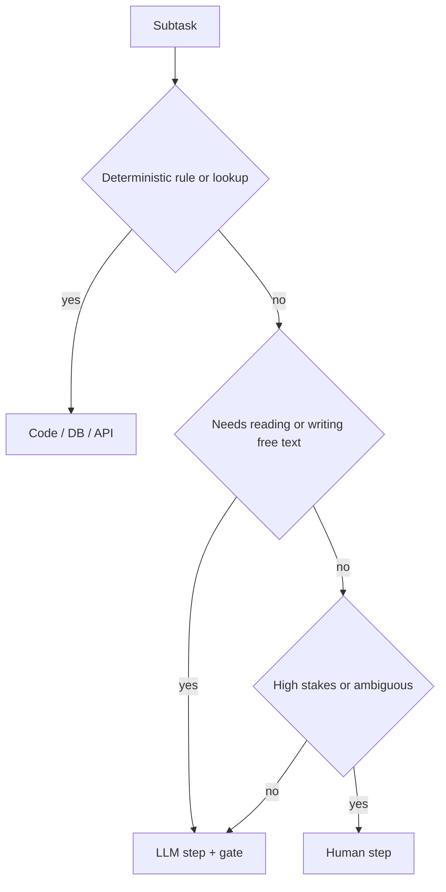

# Task Chaining

> [!abstract] TL;DR
> Task chaining links **subtasks** rather than prompts. Each link can be an LLM call, a tool or API call, a code function, or a human step. ==The chain comes from the task decomposition, and each link is given to the cheapest executor that can do it reliably.== This is how most production "agentic" workflows actually look: mostly deterministic code, with LLM calls only where text needs to be understood or judged.

**Prerequisites:** [[Chaining prompts for Agentic Reasoning]] · [[Task Decomposition]]
**Related:** [[Sequential Prompting]] · [[Gate Checks]] · [[Implementing Gate Checks]] · [[Runtime or Orchestration Layer]] · [[Tool Use]] · [[Sonar Ticket and Outage Classification - How-To]]

> [!note] Source scope
> Expands [[Chaining prompts for Agentic Reasoning#4. Task Chaining – Steps That Are Not All Prompts]]. The executor matrix, the handoff contracts and the analysis are *beyond the lecture*.

> [!todo]- Contents
> - [[#1. Core Concepts]]
> - [[#2. Choosing an Executor per Link]]
> - [[#3. Handoff Contracts and State]]
> - [[#4. Worked Example – New-Service Activation]]
> - [[#5. Pitfalls and Failure Modes]]
> - [[#6. Key Takeaways]]
> - [[#7. Critical Analysis]]
> - [[#8. Self-Test]]
> - [[#9. Glossary]]
> - [[#Further Reading]]

---

## 1. Core Concepts

> [!info]+ Definition – Task chaining
> ![[Chaining prompts for Agentic Reasoning#^def-task-chaining]]

| | [[Sequential Prompting\|Prompt chaining]] | Task chaining |
|---|---|---|
| Link | LLM call | Any subtask: LLM, tool, code, human |
| Design focus | Prompt per step ([[Stage-Specific Prompting]]) | Decomposition + executor choice + handoffs |
| Failure surface | Model errors | Model errors + API errors + data errors |
| Typical owner | Prompt engineer | Workflow or platform engineer |

> [!info]+ Definition – Executor
> The component that performs a link: an LLM, a deterministic function, an external API or tool, or a human.

^def-executor

---

## 2. Choosing an Executor per Link



| Executor | Use for | Reliability | Cost |
|---|---|---|---|
| Code | Arithmetic, rules, formatting, routing | ~1.0 | ~0 |
| API / tool | System-of-record reads and writes | High (network errors aside) | Low |
| LLM | Extraction, classification, summarising, drafting | $p<1$, needs [[Gate Checks\|gates]] | Medium |
| Human | Approval, ambiguity, exceptions | High but slow | High |

Reliability follows the product rule ([[Task Decomposition#^decomp-reliability]]). Because code links have $p\approx1$, ==moving links from an LLM to code raises end-to-end reliability for free==.

---

## 3. Handoff Contracts and State

Each link reads typed input and writes typed output. The chain passes a **state object** along, rather than raw text.

```python
class ActivationState(BaseModel):
    order_id: str
    address: Address | None = None
    serviceable: bool | None = None
    plan_id: str | None = None
    welcome_email: str | None = None

@dataclass
class Link:
    name: str
    executor: Callable[[ActivationState], ActivationState]
    gates: list[Callable] = field(default_factory=list)

chain = [
    Link("parse_order",    llm_extract,        [schema, grounding]),
    Link("check_address",  api_serviceability, [not_none]),
    Link("pick_plan",      rules_select_plan),
    Link("draft_email",    llm_draft,          [required_sections, pii]),
    Link("approve_if_biz", human_review),
]
```

A [[Runtime or Orchestration Layer|runtime / orchestration layer]] runs the chain. It handles retries, timeouts and state persistence (so a chain can resume), and logs every step. See [[Runtime or Orchestration Layer#4. A Minimal Runtime]] for a loop that runs a list of links like this one.

---

## 4. Worked Example – New-Service Activation

| # | Link | Executor | Gate |
|---|---|---|---|
| 1 | Pull the address and plan from the order email | LLM | Pydantic + address fields appear in the email |
| 2 | Check the address is serviceable | API (GIS) | Response 200. If not serviceable, STOP and notify |
| 3 | Pick the ONT model and plan code | Code rules | — |
| 4 | Create the account in billing | API | Idempotency key, no duplicate |
| 5 | Draft the welcome email | LLM ([[Stage-Specific Prompting\|writer prompt]]) | Contains install date, plan and support number |
| 6 | Business accounts: approve | Human | Sign-off |

Only 2 of 6 links are LLM calls. If each LLM link is 0.95 after its gates and the others are ~0.99, end-to-end success is about $0.95^2 \times 0.99^4 \approx 0.87$. Without the code links, you would be asking an LLM to do lookups and rule logic as well.

---

## 5. Pitfalls and Failure Modes

| Failure | Symptom | Mitigation |
|---|---|---|
| Using an LLM for deterministic work | Arithmetic or lookup errors | "Compute, don't ask". Move it to code |
| Untyped handoffs | Next link misreads the output | Pydantic state object |
| Non-idempotent side effects | Duplicate accounts on retry | Idempotency keys, check before write |
| No resume | Failure at step 5 restarts everything | Persist state after each link |
| Partial failure leaves inconsistency | Account created, email never sent | Compensating actions (saga pattern), alerts |
| Hidden human bottleneck | Chain waits for days | SLA timers, escalation |

---

## 6. Key Takeaways

- [ ] Task chains link subtasks. Only some links are LLM calls.
- [ ] Give each link the cheapest reliable executor: code, then API, then LLM, then human.
- [ ] Pass a typed state object between links.
- [ ] Side effects must be idempotent, and the chain must be able to resume.
- [ ] Gate the LLM links. Code links rarely need gates.

---

## 7. Critical Analysis

- **"Agentic" or "workflow"?** A fixed task chain is a workflow, not an autonomous agent. That is often a *good* thing: it is predictable, auditable and cheap. Add dynamic planning only where the inputs really vary ([[Planning Agents]]).
- **Evidence.** Industry guidance (e.g. Anthropic's "Building effective agents") recommends the simplest workflow that works. Formal comparisons are scarce.
- **At scale.** Orchestration concerns come to dominate: queues, retries, observability, versioning of prompts *and* code. Tools such as LangGraph, Temporal or Airflow take over from hand-written loops.
- **Security.** Tool and API links carry the real privileges. Apply least privilege for each link, and never let LLM output choose an arbitrary endpoint ([[Prompt Injection]]).

> [!question] Discussion
> 1. At what point should a fixed task chain become a dynamically planned agent?
> 2. How would you version and roll back a chain where prompts and code change independently?

---

## 8. Self-Test

> [!question]- Q1. How does task chaining differ from prompt chaining?
> Task chains link subtasks with any executor (code, API, LLM, human). Prompt chains link LLM calls only.

> [!question]- Q2. Quantitative – 5 links: 3 LLM at 0.9, 2 code at 1.0. What is P(success)? What if one LLM link moves to code?
> $0.9^3 = 0.729$. Moving one link gives $0.9^2 = 0.81$.

> [!question]- Q3. Why must side-effecting links be idempotent?
> Retries and resumes can run them again. Without idempotency you get duplicate records, charges or emails.

> [!question]- Q4. Design – chain for "customer reports slow speeds"
> LLM pulls out the symptoms, API reads line stats, code rules check thresholds, API checks for node alarms, LLM drafts the diagnosis and customer reply (with gates), and a truck roll above a cost threshold needs human approval.

> [!tip] Flashcards
> Review with [[Task Chaining - Flashcards]].

---

## 9. Glossary

| Term | Meaning |
|---|---|
| Executor | What performs a link: LLM, code, API, or human |
| State object | Typed data passed and updated along the chain |
| Idempotency key | Token that makes repeated writes safe |
| Saga / compensation | Undo steps for partial failures |

---

## Further Reading

- [Building Effective Agents – Anthropic](https://www.anthropic.com/engineering/building-effective-agents)
- [AI Chains (Wu et al., 2022)](https://arxiv.org/abs/2110.01691)
- [LangGraph documentation](https://langchain-ai.github.io/langgraph/)
