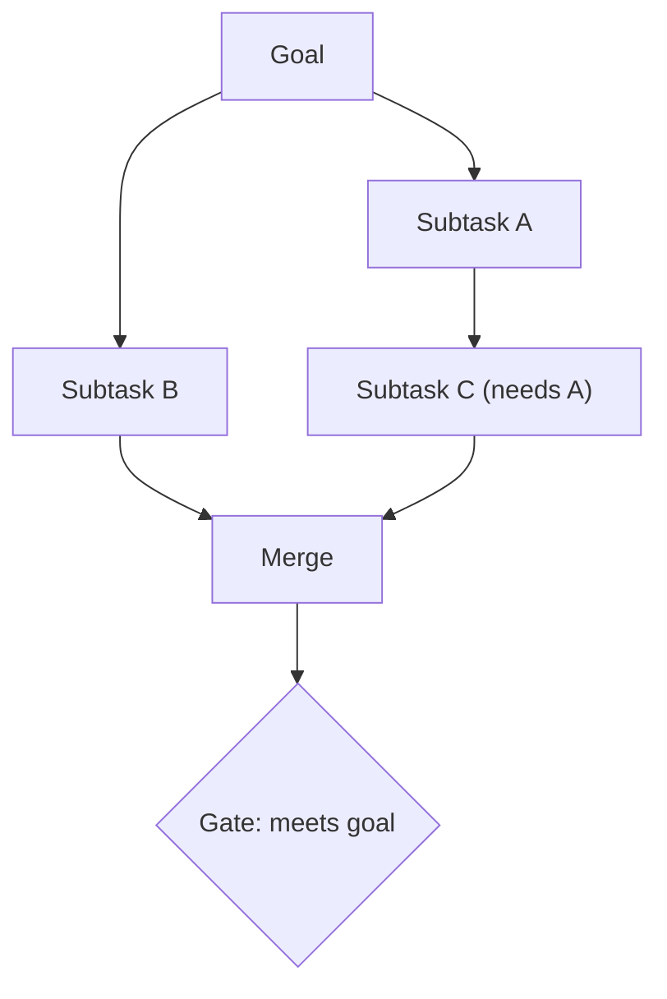

# Task Decomposition

> [!abstract] TL;DR
> Task decomposition splits a complex goal into smaller subtasks. Each subtask has one clear input, one output and one success check. ==Good decomposition raises the reliability of each step, makes each step checkable, and puts deterministic work in code.== The decomposition can be written by a person (a fixed chain) or produced by the model at runtime (a [[Planning Agents|planning agent]]). That choice trades predictability against flexibility.

**Prerequisites:** [[Prompt Engineering]] · [[Sequential Prompting]]
**Related:** [[Planning Agents]] · [[Task Chaining]] · [[Stage-Specific Prompting]] · [[Multi-Agent Systems]] · [[AI Reliability]] · [[Tree-of-Thought]]

> [!note] Source scope
> This note brings together how decomposition is used across [[Sequential Prompting]], [[Chaining prompts for Agentic Reasoning]], [[Planning Agents]] and [[Multi-Agent Systems]]. The taxonomy, the quantitative model and the research references are *beyond the lecture*.

> [!todo]- Contents
> - [[#1. Core Concepts]]
> - [[#2. Decomposition Strategies]]
> - [[#3. Why It Helps – and When It Hurts]]
> - [[#4. Worked Example – Outage Postmortem]]
> - [[#5. Pitfalls and Failure Modes]]
> - [[#6. Key Takeaways]]
> - [[#7. Critical Analysis]]
> - [[#8. Self-Test]]
> - [[#9. Glossary]]
> - [[#Further Reading]]

---

## 1. Core Concepts

> [!info]+ Definition – Task decomposition
> Breaking a goal $G$ into subtasks $\{t_1,\dots,t_n\}$ and saying how they depend on each other (a sequence, a tree, or a [[Directed Acyclic Graph (DAG)|DAG]]), so that finishing all the subtasks achieves $G$.

^def-task-decomposition

> [!info]+ Definition – A good subtask
> Has **one verb, one output, one success test**. Its input and output contract is explicit enough that a [[Gate Checks|gate]] can check it.

^good-subtask

**Who decomposes?**

| Mode | Who writes the plan | Examples | Trade-off |
|---|---|---|---|
| Static | A developer, at design time | [[Sequential Prompting]], [[Task Chaining]] | Predictable and testable, but brittle when inputs are new |
| Dynamic | The LLM, at runtime | [[Planning Agents]], plan-and-execute, orchestrator-workers | Adapts to the input, but harder to test and can over-plan |
| Hybrid | Fixed skeleton, LLM fills the branches | Routing + sub-chains | Usually the best choice in production |

---

## 2. Decomposition Strategies

| Strategy | Split by | Example |
|---|---|---|
| **Functional / pipeline** | Stage of processing | extract → classify → draft → review |
| **Hierarchical** | Goal → sub-goals → actions | "Plan trip" → flights / hotel / itinerary |
| **Data-parallel (map-reduce)** | Chunks of the input | Summarize each doc, then merge |
| **Least-to-most** | Easier sub-questions first | Solve the simple case, then build on it |
| **By capability** | Which tool or agent owns it | Search agent, code agent, writer agent ([[Multi-Agent Systems]]) |
| **By verifiability** | What can be checked | Split out the parts code can check |

> [!tip] The "does this need an LLM" test
> For each subtask, ask whether an LLM is needed at all. Lookups, arithmetic and routing rules belong in code. See [[Chaining prompts for Agentic Reasoning#4. Task Chaining – Steps That Are Not All Prompts]].

---

## 3. Why It Helps – and When It Hurts

A single prompt that does everything has some per-task success rate $p_{mono}$. With $n$ steps in series, each with success rate $p_i$:

$$
P(\text{success}) = \prod_{i=1}^{n} p_i
$$

^decomp-reliability

Decomposition only pays off if each $p_i$ goes up enough to make up for having more steps. Take a monolithic prompt at $p_{mono}=0.70$. Three steps at $0.95$ each give $0.95^3 \approx 0.86$, which is a win. Six steps at $0.93$ give $0.93^6 \approx 0.65$, which is a loss. [[Gate Checks|Gates]] with retries raise the effective $p_i$. This is why decomposition and validation go together ([[AI Reliability]]).

| Helps when | Hurts when |
|---|---|
| The task mixes skills (extraction and judgment) | The task is short and one prompt already does it well |
| Intermediate results can be checked | Steps are so fine that context is lost between them |
| Parts can run in parallel | Latency or cost budgets are tight |
| Different steps need different models or tools | Handoffs drop information |

---

## 4. Worked Example – Outage Postmortem

Goal: *"Write a postmortem for last night's fiber outage."*

| # | Subtask | Executor | Output | Gate |
|---|---|---|---|---|
| 1 | Pull the alarm timeline | Code (NMS API) | Timestamped events | Non-empty, sorted |
| 2 | Pull affected tickets | Code (Sonar query) | List of tickets | Count > 0 |
| 3 | Pull out the root-cause evidence | LLM | Claims + quotes | Quotes found in the logs |
| 4 | Estimate customer impact | Code | Numbers | Totals add up |
| 5 | Draft the postmortem | LLM ([[Stage-Specific Prompting\|writer prompt]]) | Markdown | Required sections present |
| 6 | Review | LLM judge + human | Approve / edit | Human sign-off |

Two of the six steps use an LLM. Steps 1, 2 and 4 can run in parallel.

---

## 5. Pitfalls and Failure Modes

| Failure | Symptom | Mitigation |
|---|---|---|
| Over-decomposition | Many calls, context lost, lower end-to-end $p$ | Merge steps that have no checkable boundary between them |
| Under-decomposition | Output that is almost right but can't be debugged | Split wherever you can write a test |
| Leaky contracts | Step B has to guess what A meant | Typed handoffs (Pydantic) |
| Missing subtasks | Output that looks complete but has gaps | A coverage gate that checks the plan against the goal |
| Plan drift (dynamic) | The agent wanders from the goal | Replan with checkpoints, step limits |
| Hidden dependencies | Parallel steps conflict | Model the work as a [[Directed Acyclic Graph (DAG)\|DAG]] |

---

## 6. Key Takeaways

- [ ] Each subtask gets one verb, one output and one success test.
- [ ] End-to-end reliability is the product of the step success rates, so decompose only when each $p_i$ rises enough.
- [ ] Static decomposition is predictable. Dynamic decomposition is flexible. Hybrid is usually best.
- [ ] Put deterministic subtasks in code.
- [ ] Decompose along the lines where checks are possible.

---

## 7. Critical Analysis

- **Evidence.** Least-to-most and decomposed prompting show gains on reasoning benchmarks. Gains on messy real-world tasks are mostly anecdotal. As models get stronger, the benefit of hand-written decomposition may shrink for tasks that fit in one context window.
- **At scale.** Dynamic decomposition makes cost and latency unpredictable. You need budget caps and plan caching.
- **Evaluation.** Test each subtask on its own (unit evals) *and* the whole chain end-to-end. Also measure plan quality: coverage, redundancy and order.
- **Security.** Each extra step is another place for [[Prompt Injection]] to get in, especially when retrieved text shapes the plan. Keep plans in a structured format and allow-list the actions.

> [!question] Discussion
> 1. At what model capability does a fixed chain lose to one long-context prompt?
> 2. Should the planner and executor be different models? Why?

---

## 8. Self-Test

> [!question]- Q1. What makes a good subtask?
> One verb, one output, one success test, and an explicit input/output contract that a gate can check.

> [!question]- Q2. Quantitative – one prompt succeeds 75% of the time. You split it into 4 steps at 0.94 each. Better or worse?
> $0.94^4 \approx 0.78$. Slightly better. Adding gates with retries on each step would raise it further.

> [!question]- Q3. Static vs dynamic decomposition – when would you choose each?
> Static for known, repeated workflows where you need testability and compliance. Dynamic for open-ended tasks whose structure depends on the input.

> [!question]- Q4. Design – decompose "answer a customer billing dispute".
> Identify the customer (code), pull the invoices (code), pull out the disputed item (LLM + grounding gate), check the policy (code/RAG), draft a reply (LLM), and send refunds above a threshold for human approval.

> [!tip] Flashcards
> Review with [[Task Decomposition - Flashcards]].

---

## 9. Glossary

| Term | Meaning |
|---|---|
| Subtask contract | The input/output schema and success test for a step |
| Least-to-most | Prompting that solves easier sub-problems first |
| Plan-and-execute | Planner produces the steps, then an executor runs them |
| Over-decomposition | Splitting a task so finely that reliability or context suffers |

---

## Further Reading

- [Least-to-Most Prompting (Zhou et al., 2022)](https://arxiv.org/abs/2205.10625)
- [Decomposed Prompting (Khot et al., 2022)](https://arxiv.org/abs/2210.02406)
- [Plan-and-Solve Prompting (Wang et al., 2023)](https://arxiv.org/abs/2305.04091)
- [Building Effective Agents – Anthropic](https://www.anthropic.com/engineering/building-effective-agents)
