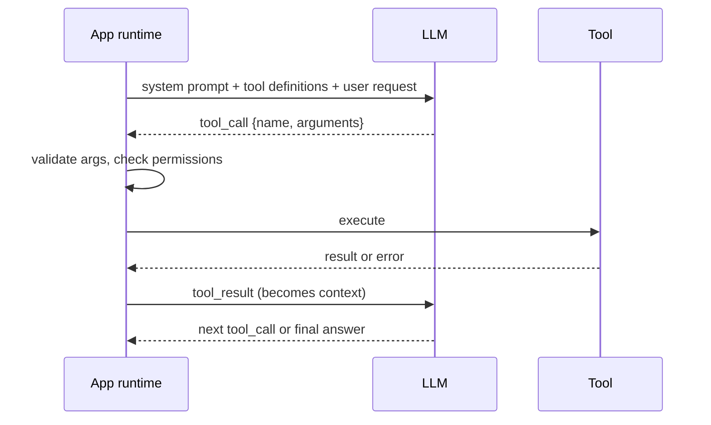

# Tool Descriptions in Agentic Systems

> [!abstract] TL;DR
> An agent knows about a tool only through its **name, description and input schema**, all of which are placed in the model's context. ==Tool descriptions are prompt engineering==: they decide *whether* the model calls a tool, *which* one, *when*, and *with what arguments*. Treat the tool set as an **agent-computer interface (ACI)**. Give each tool one purpose, clear usage conditions, typed and constrained parameters, concise results and actionable errors. Then ==test tools with evals the same way you test prompts==.

**Prerequisite:** [[Prompt Instruction Refinement#3. Best Practices (A06)|A06 best practice 7 – optimize tool descriptions]] · [[Tool Use]]
**Related:** [[AI Agents]] · [[Chain-of-Thought and ReAct]] (ReAct actions are tool calls) · [[Prompt Chaining for Agentic Reasoning - Study Guide]] · [[Few-Shot Prompting]] · [[Prompt Injection]] · [[Model Context Protocol]]

**Sources:** This is a synthesis note. The lecture content is A06 in [[Prompt Instruction Refinement]]: "spend real time on tool descriptions and I/O schemas". The pitfall there is that with poor tool descriptions "the agent won't know how or when to use its tools". The design principles, scaling analysis and examples are *beyond the lecture* (see [[#Further Reading]]).

> [!todo]- Contents
> 1. [[#1. Core Concepts]]
> 2. [[#2. Anatomy of a Tool Definition]]
> 3. [[#3. Design Principles]]
> 4. [[#4. Tool Selection at Scale]]
> 5. [[#5. Worked Example]]
> 6. [[#6. Evaluating Tools]]
> 7. [[#7. Pitfalls and Failure Modes]]
> 8. [[#8. Key Takeaways]]
> 9. [[#9. Critical Analysis]]
> 10. [[#10. Self-Test]]
> 11. [[#11. Glossary]]

---

## 1. Core Concepts

> [!info]+ Definition – Tool (function) calling
> A model capability in which the LLM, given a list of tool definitions, outputs a **structured request** to call a tool (name plus JSON arguments) instead of plain text. The **application runtime** executes the call and returns the result to the model as a new message. The model never runs the tool itself.

^def-tool-calling

> [!info]+ Definition – Tool description
> The natural-language and schema metadata that defines a tool for the model: **name**, **description** (purpose, when to use it, what it returns) and **input schema** (usually JSON Schema). It's the model's *only* source of knowledge about the tool.

^def-tool-description

> [!info]+ Definition – Agent-computer interface (ACI)
> The set of tools, their descriptions and their result formats, seen as an *interface designed for an LLM user*. It's the counterpart of a human-computer interface (HCI). The term comes from the SWE-agent work and Anthropic's agent guidance.

^def-aci



> [!tip] Why this matters
> In a [[Chain-of-Thought and ReAct|ReAct]] loop, every *Action* is a tool call. If the model picks the wrong tool or malforms its arguments, the loop wastes steps or fails. Bad descriptions show up as **extra loop iterations**, and those compound cost and error rates ([[Prompt Chaining for Agentic Reasoning - Study Guide#^error-compounding]]).

---

## 2. Anatomy of a Tool Definition

| Field | What to put in it | Common mistake |
|---|---|---|
| **Name** | Verb–noun, specific, namespaced if many tools exist (`monitoring_get_interface_stats`) | `query`, `run`, `helper` |
| **Description: purpose** | What it does, in one or two sentences | Restating the name |
| **Description: when to use** | Conditions, and ==when *not* to use it (point to the alternative tool)== | Omitted, so the model guesses between overlapping tools |
| **Description: returns** | Shape and meaning of the result, units, limits (e.g. "max 50 rows") | Undocumented output |
| **Description: side effects** | Whether it writes, sends, deletes or costs money; whether it's reversible | Destructive tools look harmless |
| **Parameters** | Types, `enum`s, formats (ISO-8601, units), defaults, a short example value | Free-text `string` for everything |
| **Required fields** | Only what's truly required | Everything required, so the model invents values |
| **Errors** | Actionable messages ("`device_id` not found; call `search_devices` first") | Stack traces or `Error 500` |

> [!example] Weak vs. strong definition
> ```json
> {
>   "name": "query",
>   "description": "Queries the system.",
>   "input_schema": {"type": "object", "properties": {"q": {"type": "string"}}}
> }
> ```
> ```json
> {
>   "name": "monitoring_get_interface_utilization",
>   "description": "Returns current inbound/outbound utilization (% of capacity) for every interface on ONE network device. Use after confirming the device is reachable with monitoring_get_device_status. For trends over time, use monitoring_get_traffic_history instead. Read-only.",
>   "input_schema": {
>     "type": "object",
>     "properties": {
>       "device_id": {"type": "string", "description": "Device ID from monitoring_search_devices, e.g. 'twr-a-rtr01'"},
>       "direction": {"type": "string", "enum": ["in", "out", "both"], "default": "both"}
>     },
>     "required": ["device_id"]
>   }
> }
> ```

---

## 3. Design Principles

1. **One clear purpose per tool.** Overlapping tools are the most common cause of wrong selection.
2. **Write for a smart new hire.** Include the context a new colleague would need: domain terms, ID formats, the order in which calls are usually made.
3. **Say when *not* to use it.** Cross-reference the sibling tool.
4. **Constrain with the schema, not with prose.** `enum`, `format`, `minimum` and `pattern` are enforced by validation. Prose is only a suggestion.
5. **Poka-yoke the arguments** (mistake-proofing). Make errors hard to make. Examples: require absolute paths, accept IDs instead of free-text names, avoid easy-to-confuse parameter pairs.
6. **Design tools around tasks, not endpoints.** One `schedule_meeting` beats a chain of `list_users` → `get_calendar` → `create_event` when the agent always needs all three. The fewer steps, the lower $p^n$ risk.
7. **Return high-signal, token-efficient results.** Summaries, IDs plus human-readable names, and pagination or truncation with a hint ("47 more; refine with `site=`"). Don't dump raw data.
8. **Make errors instructive.** An error message is the next prompt the model reads. It should say how to recover.
9. **Mark side effects and irreversibility.** This also lets the runtime gate those tools behind confirmation ([[Prompt Injection#4. Defenses – Defense in Depth]]).
10. **Keep descriptions consistent with examples.** If you include [[Few-Shot Prompting|few-shot]] tool-call examples, they must match the current schema.

^tool-design-principles

> [!important] Same lesson as the lecture
> Everything in [[Prompt Instruction Refinement]] applies here. Ambiguity is the top pitfall, explicit beats implicit, and you refine one component at a time. The "component" is now a tool's name, description or schema.

---

## 4. Tool Selection at Scale

Tool definitions sit in the context on **every call**:

$$
T_{\text{tools}} = \sum_{i=1}^{N} t_i \approx N \cdot \bar{t}
$$

> [!example] Quick math
> 40 tools × ~250 tokens = **10,000 tokens** of tool definitions per model call. A 12-step ReAct run re-sends them 12 times, so ~120 k input tokens *before* any task content (prompt caching reduces the cost, but the definitions still take up context).

Beyond token cost, **selection accuracy tends to fall** as the number of tools and their similarity grow. The model has more near-duplicates to tell apart.

| Strategy | How | Trade-off |
|---|---|---|
| **Consolidate** | Merge fine-grained tools into task-level tools | Less flexible, but fewer choices |
| **Namespace** | Prefixes such as `crm_`, `monitoring_` | Cheap, helps disambiguation |
| **Route to toolsets** | A router step picks a domain; only that domain's tools are loaded ([[Prompt Chaining for Agentic Reasoning - Study Guide#4.3 Routing]]) | An extra call; misroutes |
| **Tool retrieval** | Embed the descriptions and load the top-k relevant tools per request | Retrieval errors hide the needed tool |
| **Sub-agents** | Specialist agents each own a small toolset ([[Multi-Agent Systems]]) | Coordination overhead |

> [!note] Standardization
> The [[Model Context Protocol]] (MCP) standardizes how tools, and their descriptions, are exposed to agents by servers. That makes plug-in tools easy to add, and it means *you often don't write the descriptions your agent reads*. See [[#9. Critical Analysis]].

---

## 5. Worked Example

**Context:** the network-operations ReAct agent from [[Chain-of-Thought and ReAct#Example Network Operations]]. It diagnoses packet loss on Tower A.

| Version | Tool set | Observed behavior |
|---|---|---|
| v1 | One tool: `query(q: string)`, "Queries the system." | The model writes free-text queries in varied formats. Many calls fail, and a run takes 9 steps with 4 errors |
| v2 | 3 tools: `get_device_status`, `get_interface_utilization`, `get_traffic_history`. Typed IDs; descriptions state the call order and when not to use each | 3–4 steps, following the reachability → interfaces → history sequence |
| v3 | v2 plus instructive errors ("unknown device_id; use `search_devices`"), results with baseline comparison ("98% vs 30-day median 55%") | Fewer steps. The model draws the conclusion "abnormal congestion" from the tool output instead of computing it |

> [!success] Takeaway
> Nothing changed in the model or the system prompt. **Only the ACI changed.** Step count, error rate and answer quality all improved. That's why the lecture calls tool descriptions a primary prompt-engineering lever.

---

## 6. Evaluating Tools

1. **Build realistic eval tasks** that need 1–N tool calls, including cases where *no* tool should be called.
2. **Measure:** tool-selection accuracy, argument validity rate, calls per task, tokens per task, task success, and error-recovery rate.
3. **Read transcripts.** Where did the model hesitate, pick the wrong tool or misread a result? The fix is usually in the description.
4. **Change one thing at a time**, following the refinement loop in [[Prompt Instruction Refinement#5. The Refinement Loop]].
5. **Hold out a test set** so you don't overfit descriptions to your dev tasks.
6. **Re-run on model upgrades.** Tool-use behavior differs across models (prompts aren't portable, A06).

See [[LLM Evaluation]] for general evaluation design.

---

## 7. Pitfalls and Failure Modes

| Failure | Symptom | Mitigation |
|---|---|---|
| **Overlapping tools** | Wrong tool chosen, or tools alternated at random | Merge them, or add "use X instead when…" |
| **Vague parameters** | Hallucinated or malformed arguments | Enums, formats, examples, ID lookups |
| **Everything required** | The model invents values for fields it doesn't know | Make fields optional with sensible defaults |
| **Verbose results** | Context fills up; the model loses the thread | Summarize, paginate, truncate with hints |
| **Opaque errors** | Retry loops with the same bad call | Actionable error messages |
| **Hidden side effects** | Destructive action taken casually | State side effects; runtime confirmation gates |
| **Tool bloat** | High cost; selection accuracy falls | Consolidate, route or retrieve tools ([[#4. Tool Selection at Scale]]) |
| **Description–behavior drift** | The tool changed but the description didn't | Version descriptions with the code; test in CI |
| **Untrusted descriptions** | Third-party tool text steers the agent (tool poisoning) | Review and pin tool servers; see [[Prompt Injection]] |

---

## 8. Key Takeaways

- [ ] The model knows a tool **only** through its name, description and schema.
- [ ] Tool descriptions are prompt engineering (A06). Ambiguity is still the top failure.
- [ ] Every description should state **purpose, when to use, when not, returns, side effects**.
- [ ] Constrain with the schema (enums, formats), not only prose.
- [ ] Design task-level tools; return concise, high-signal results; write instructive errors.
- [ ] Tool definitions cost tokens on *every* call. Many tools reduce selection accuracy.
- [ ] Evaluate tools with task-based evals and transcript review, and re-test on model changes.
- [ ] Third-party tool descriptions are an injection surface.

---

## 9. Critical Analysis

- **Evidence quality.** Most guidance on tool design comes from practitioner reports (vendor engineering blogs, SWE-agent's ACI ablations), not controlled studies across models. The principles are consistent across sources, but effect sizes depend on the model and the task. Measure them on your own evals.
- **Who writes the description?** With MCP and tool marketplaces, the tool *author* controls text that goes straight into *your* agent's context. That's both a quality risk (poor descriptions) and a security risk: tool poisoning, and "rug pulls", where a description changes after you approved it. Pin versions and review diffs.
- **Descriptions vs. fine-tuning.** Models trained heavily on tool use (e.g. Toolformer-style self-supervision, or vendors' function-calling training) are more robust to mediocre descriptions. Robustness is not correctness, though: a well-trained model will still confidently choose the wrong tool among near-duplicates.
- **At scale.** With hundreds of tools, *tool retrieval* becomes a RAG problem with its own recall failures ([[Retrieval-Augmented Generation]]). If the needed tool isn't retrieved, the agent can't succeed, and it may improvise with the wrong tool.
- **Safety by design.** The description can *tell* the model a tool is destructive, but only the **runtime** can *enforce* confirmation. Never rely on the description alone for safety. Pair it with permissions ([[Prompt Injection#^defense-layers]]).

> [!question] Open questions
> 1. When should logic live in the tool (deterministic code) instead of in the agent's reasoning?
> 2. How would you detect description–behavior drift automatically?
> 3. Should agents be allowed to *propose* improvements to their own tool descriptions from transcript analysis?

---

## 10. Self-Test

> [!question]- Q1. Name the five things a strong tool description should state.
> Purpose, when to use it, when *not* to use it (and the alternative), what it returns (shape, units, limits), and side effects / reversibility.

> [!question]- Q2. Why prefer an `enum` over a prose instruction like "direction should be in, out or both"?
> The schema is validated deterministically, so invalid values are rejected before execution and the model's constrained decoding can use it. Prose is only a suggestion the model may ignore.

> [!question]- Q3. Quantitative: 25 tools at 300 tokens each; an average run takes 8 model calls. How many tool-definition tokens per run?
> $25 \times 300 = 7{,}500$ tokens per call; $\times 8 = 60{,}000$ tokens per run (before caching). That's a reason to consolidate or dynamically load tools.

> [!question]- Q4. Design: an agent confuses `search_customers` and `get_customer`. Give two fixes.
> (1) Descriptions that cross-reference each other: "Use `search_customers` when you only have a name or email; it returns IDs. Use `get_customer` when you already have an ID." (2) Make `get_customer` take a typed `customer_id` with a format pattern, so it can't be called with a name. Or merge the two into one tool with optional parameters.

> [!question]- Q5. Why is an error message part of the prompt?
> The tool result, including an error, goes back into the model's context and shapes its next action. An actionable error ("unknown ID; call `search_devices` first") guides recovery. An opaque one causes retry loops.

> [!question]- Q6. What security risk arises when tool descriptions come from third-party MCP servers?
> The description text enters the agent's context unfiltered. A malicious or compromised server can embed instructions (tool poisoning) or change the description after approval (a rug pull). Mitigate by reviewing and pinning servers, least privilege, and runtime confirmation for side-effecting tools.

### Flashcards
> [!tip] Spaced repetition deck
> The flashcards for this note are in [[Tool Descriptions in Agentic Systems - Flashcards]]. Review them with the **Review flashcards** ribbon icon (or the command palette → *Spaced Repetition: Review flashcards*).

---

## 11. Glossary

| Term | Definition |
|---|---|
| **Tool / function calling** | The model emits a structured call; the runtime executes it and returns the result |
| **Input schema** | JSON Schema defining a tool's parameters |
| **ACI** | Agent-computer interface: tools and their results designed for LLM users |
| **Poka-yoke** | Designing an interface so mistakes are hard to make |
| **Tool retrieval** | Selecting relevant tool definitions per request by similarity search |
| **Tool poisoning** | Malicious instructions hidden in tool metadata |
| **Rug pull** | A tool's description or behavior changing after it was approved |

---

## Further Reading
- [Building Effective Agents](https://www.anthropic.com/engineering/building-effective-agents), Anthropic (appendix on prompt-engineering your tools / ACI)
- [Writing effective tools for agents](https://www.anthropic.com/engineering/writing-tools-for-agents), Anthropic
- [Tool use documentation](https://docs.anthropic.com/en/docs/build-with-claude/tool-use), Anthropic
- [SWE-agent: Agent-Computer Interfaces Enable Automated Software Engineering](https://arxiv.org/abs/2405.15793), Yang et al., 2024
- [Toolformer](https://arxiv.org/abs/2302.04761), Schick et al., 2023
- [Gorilla: Large Language Model Connected with Massive APIs](https://arxiv.org/abs/2305.15334), Patil et al., 2023
- [Model Context Protocol](https://modelcontextprotocol.io)

%% Study hint: the worked example reuses the Tower A scenario from Chain-of-Thought and ReAct, so review the two together. %%
