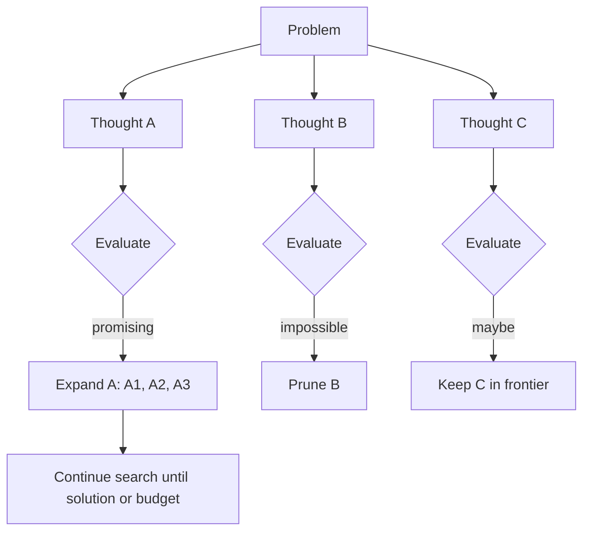

# Tree-of-Thought

> [!abstract] TL;DR
> Tree-of-Thought (ToT) generalizes [[Chain-of-Thought and ReAct|chain-of-thought]] from one reasoning path to a **search tree**: the model proposes several candidate "thoughts" at each step, ==an evaluator scores them, and a search algorithm (BFS/DFS/beam) expands the promising ones and backtracks from dead ends==. It helps on problems that need exploration and lookahead (puzzles, planning), at many times the token cost of CoT.

**Prerequisites:** [[Chain-of-Thought and ReAct]] · [[Prompt Engineering]]
**Related:** [[Planning Agents]] · [[Model Predictive Control (MPC)]] · [[Reinforcement Learning (RL)]] · [[AI Reliability]]

> [!note] Source scope
> Concept hub based on Yao et al. (2023). *Beyond the lecture.*

> [!todo]- Contents
> - [[#1. Core Concepts]]
> - [[#2. How ToT Works]]
> - [[#3. Comparison with Other Reasoning Methods]]
> - [[#4. Worked Example – Game of 24]]
> - [[#5. Pitfalls and Failure Modes]]
> - [[#6. Key Takeaways]]
> - [[#7. Critical Analysis]]
> - [[#8. Self-Test]]
> - [[#9. Glossary]]
> - [[#Further Reading]]

## 1. Core Concepts

> [!info]+ Definition – Tree-of-Thought
> A reasoning framework where an LLM generates multiple intermediate "thoughts" per step, evaluates each partial solution, and uses a search algorithm to explore, prune and backtrack over the resulting tree.

^def-tot

Four design components (Yao et al., 2023):

| Component | Question | Options |
|---|---|---|
| Thought decomposition | What is one step? | A line of an equation, a sentence, a plan step |
| Thought generator | How are candidates made? | Sample $k$ independent thoughts, or propose $k$ in one call |
| State evaluator | How good is a partial solution? | LLM scores (value 1–10, "sure/maybe/impossible") or votes across states; external checks |
| Search algorithm | What to expand next? | BFS (keep best $b$ per level), DFS with backtracking, beam search |

## 2. How ToT Works

**Cost.** With branching factor $k$, depth $d$ and beam width $b$, BFS with beam makes roughly $d \cdot b \cdot k$ generation calls plus as many evaluation calls. A full tree without pruning grows as $k^d$ — pruning is what makes it tractable.

The idea is the same as planning in control: [[Model Predictive Control (MPC)]] simulates several future trajectories and picks the best first action; ToT does the same with language-model "simulations". Using a value estimate to guide search also connects to [[Reinforcement Learning (RL)]] (e.g. MCTS).

## 3. Comparison with Other Reasoning Methods

| Method | Structure | Backtracking | Relative cost | Best for |
|---|---|---|---|---|
| Direct prompting | One answer | No | 1× | Simple tasks |
| Chain-of-Thought | One path | No | ~1–2× | Multi-step arithmetic, logic |
| Self-consistency | $n$ independent paths, majority vote | No | $n$× | Tasks with one checkable final answer |
| ReAct | Path interleaved with tool calls | Via observations | Varies | Tasks needing external info ([[Chain-of-Thought and ReAct]]) |
| **Tree-of-Thought** | Tree + evaluator + search | **Yes** | often 10–100× | Search/puzzle/planning tasks |
| Graph-of-Thoughts | Graph (merge/refine thoughts) | Yes | High | Tasks where partial solutions combine |

## 4. Worked Example – Game of 24

Use 4, 9, 10, 13 with + − × ÷ to make 24. Each thought = one operation that combines two numbers.

- Level 1 candidates: `13 − 9 = 4 (left 4, 4, 10)`, `10 − 4 = 6 (left 6, 9, 13)`, `4 + 9 = 13 (left 10, 13, 13)`.
- Evaluator (LLM asked "can these reach 24: sure/maybe/impossible?"): `4, 4, 10` → maybe; `6, 9, 13` → maybe; `10, 13, 13` → impossible → prune.
- Expand `4, 4, 10`: `10 − 4 = 6 (left 4, 6)` → `4 × 6 = 24` ✓.
- Solution: $(10 - 4) \times (13 - 9) = 24$.

Yao et al. (2023) report GPT-4 solving 4% of these puzzles with CoT and 74% with ToT (breadth $b=5$) — a large gain on a task designed around search.

## 5. Pitfalls and Failure Modes

| Failure | Symptom | Mitigation |
|---|---|---|
| Unreliable evaluator | Good branches pruned, bad ones kept | Use programmatic checks where possible; vote across several evaluations |
| Cost explosion | Hundreds of calls per problem | Beam width, depth limit, early stop on a verified solution |
| Low diversity | All $k$ thoughts are near-identical | Propose-in-one-call prompts; higher temperature |
| Wrong thought granularity | Steps too big (no benefit) or too small (deep tree) | Pick steps the evaluator can judge |
| Used on easy tasks | Same answer as CoT at 50× cost | Route: only use ToT when CoT fails an eval |

## 6. Key Takeaways

- [ ] I can name ToT's four components: decomposition, generator, evaluator, search.
- [ ] I know how ToT differs from CoT and self-consistency (evaluation + backtracking).
- [ ] I can estimate ToT cost from $k$, $b$ and $d$.
- [ ] I know the evaluator is the weak point, and prefer programmatic checks.
- [ ] I can link ToT to planning ideas like MPC and MCTS.

## 7. Critical Analysis

- **Task selection.** The big reported gains come on tasks built for search (Game of 24, crosswords). On everyday tasks, CoT or self-consistency often gets most of the benefit for far less cost.
- **Evaluator ceiling.** ToT can't beat the model's ability to judge partial solutions. With an external verifier (unit tests, a solver), it becomes much stronger — the search is only as good as its value function.
- **Relevance today.** Reasoning-trained models perform internal search-like reasoning, which reduces the need for explicit ToT scaffolding for many tasks. Explicit trees remain useful when you want controllable budgets, verifiers and inspectable search.
- **At scale.** Latency (sequential depth) and cost make ToT hard to use in interactive products; batch and offline planning are more natural fits.
- **Security.** Mostly indirect: more calls means more exposure if any branch reads untrusted content, and cost blow-ups can be triggered by adversarial inputs (budget limits are a defense).
- **Open questions:** When does explicit search beat a reasoning model's internal deliberation at equal compute? How can evaluators be calibrated?

## 8. Self-Test

> [!question]- Q1. What two things does ToT add to chain-of-thought?
> Multiple candidate thoughts evaluated at each step, and a search algorithm that can prune and backtrack.

> [!question]- Q2. Quantitative – $k=3$ candidates per node, depth 4. How many leaves in a full tree, and roughly how many generation calls with beam $b=2$?
> Full tree: $3^4 = 81$ leaves. Beam: about $d \cdot b \cdot k = 4 \cdot 2 \cdot 3 = 24$ generation calls, plus evaluations.

> [!question]- Q3. How does ToT differ from self-consistency?
> Self-consistency samples complete independent paths and votes on the final answer. ToT evaluates *partial* solutions and uses them to steer the search.

> [!question]- Q4. Design – you want to use ToT to plan a data-migration sequence. What evaluator would you use?
> A programmatic one where possible: a dependency checker that rejects orders violating foreign keys, plus an LLM score for risk. Programmatic checks prune reliably.

> [!question]- Q5. When is ToT a poor choice?
> Simple tasks, latency-sensitive interactive use, or when you have no reliable way to evaluate partial solutions.

> [!tip] Flashcards
> Review this topic with [[Tree-of-Thought - Flashcards]].

## 9. Glossary

| Term | Meaning |
|---|---|
| Thought | One coherent intermediate reasoning step |
| Branching factor $k$ | Candidates generated per node |
| Beam width $b$ | Nodes kept per level |
| State evaluator | Scores how promising a partial solution is |
| Backtracking | Returning to an earlier node after a dead end |
| Self-consistency | Majority vote over several CoT samples |

## Further Reading

- [Yao et al. (2023) – Tree of Thoughts: Deliberate Problem Solving with Large Language Models](https://arxiv.org/abs/2305.10601)
- [Wang et al. (2022) – Self-Consistency Improves Chain of Thought Reasoning](https://arxiv.org/abs/2203.11171)
- [Besta et al. (2023) – Graph of Thoughts](https://arxiv.org/abs/2308.09687)
- [Wei et al. (2022) – Chain-of-Thought Prompting](https://arxiv.org/abs/2201.11903)
