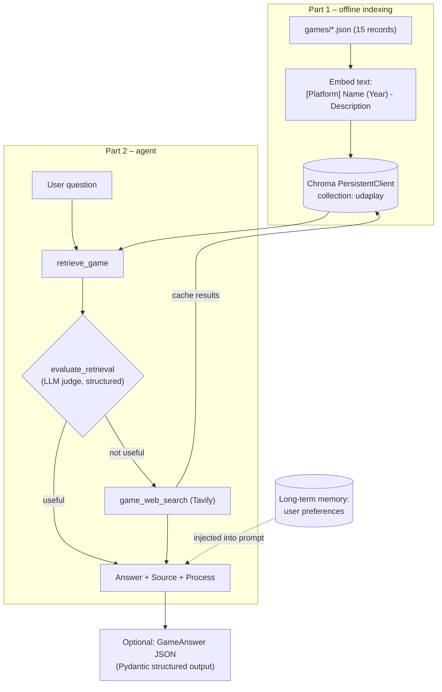
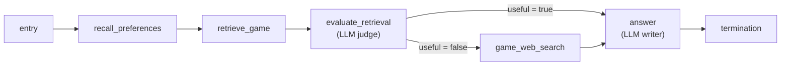

# UdaPlay Agentic AI Project

> [!abstract] TL;DR
> UdaPlay is the capstone of the *Building Agents* section: a research agent for the video-game industry that answers from a **local vector database of 15 games**, judges whether what it retrieved is good enough, and **falls back to Tavily web search** when it isn't, citing sources. The finished project goes further, in four directions this note focuses on:
> 1. **Web-search caching.** Every web result is written back into the persistent vector DB, so a repeat question is answered from the cache with its original URLs.
> 2. **Long-term memory.** User preferences are recalled and injected into the system prompt.
> 3. **The agent rebuilt as a deterministic state machine** with tools as nodes.
> 4. **Structured JSON output** validated by Pydantic.
>
> ==The project's main lesson is the shift from *LLM-decided* control flow (the model is told the process in a prompt) to *code-decided* control flow (the workflow enforces it). The LLM is kept only where judgement is needed: grading retrieval and writing the answer.==

**Prerequisites:** [[Agent Based RAG]] · [[Agentic RAG]] · [[Long-Term Agent Memory]] · [[Agent State Management]] · [[Structured Outputs]]
**Related:** [[Implementing Agent State Management with Python]] · [[Web Search and Browsing for AI Agents]] · [[Agent Evaluation]] · [[Pydantic for Structured LLM Output - Study Guide]] · [[Gate Checks]] · [[APIs in AI Systems]]

> [!note] Source scope
> Based on `python notebooks/UdaPlay Agentic AI Demo/`: `README.md`, `Project instructions.md`, `Scenario_and_Spec.md`, the game JSON files, `Udaplay_01_starter_project.ipynb` (Part 1), `Udaplay_02_starter_project.ipynb` (Part 2, code and recorded outputs) and `lib/` (`agents.py`, `memory.py`, `vector_db.py`, `llm.py`, `parsers.py`, `state_machine.py`). The `.env` file was not opened. Analysis, improvements and quantitative estimates are mine and marked *analysis*.

> [!todo]- Contents
> - [[#1. The Brief]]
> - [[#2. Architecture Overview]]
> - [[#3. Part 1 – The Persistent Game Database]]
> - [[#4. Part 2 – The Three Tools]]
> - [[#5. Version A – The LLM-Driven Agent]]
> - [[#6. Web-Search Caching]]
> - [[#7. Long-Term Memory – Preferences]]
> - [[#8. Version B – The Agent as a State Machine]]
> - [[#9. Structured JSON Output]]
> - [[#10. Recorded Results]]
> - [[#11. How the Project Ties the Section Together]]
> - [[#12. Gaps and Improvements]]
> - [[#13. Pitfalls and Failure Modes]]
> - [[#14. Key Takeaways]]
> - [[#15. Critical Analysis]]
> - [[#16. Self-Test]]
> - [[#17. Glossary]]
> - [[#Further Reading]]

---

## 1. The Brief

**Scenario.** An AI engineer at a gaming-analytics company builds **UdaPlay**, an assistant that executives, analysts and gamers can ask natural-language questions such as "Who published *GTA: San Andreas*?" or "What is Rockstar Games working on right now?". The first kind is answerable from the local dataset; the second needs the web.

| Requirement (spec) | Where it's met |
|---|---|
| Answer from internal knowledge (RAG over 15 games) | `retrieve_game` over the Chroma collection `udaplay` |
| Assess retrieval quality; fall back when confidence is low | `evaluate_retrieval` (LLM judge) → `game_web_search` |
| Web search via Tavily when internal data is insufficient | `game_web_search` |
| Clean, structured answer that **cites its source** | `Answer / Source / Process` format; URLs from the web |
| Remember earlier questions **within a session** | Agent's session-keyed short-term memory |
| *Stand-out:* long-term memory across sessions | `MemoryAgent` + `LongTermMemory` preferences |
| Make the process visible (retrieve → evaluate → search → answer) | Each tool prints its step; the workflow reports its path |
| Run at least 3 queries, including one the dataset can't answer | Pokémon and Mario (in the dataset), *Mortal Kombat X* (not) |

^requirements

---

## 2. Architecture Overview



^architecture

Four progressively more engineered versions are built and run on the same queries:

| Version | Control flow | Memory | Output |
|---|---|---|---|
| A. Baseline agent | LLM chooses tools, following a process written in its instructions | Session only | Text: Answer / Source / Process |
| A + memory | Same | + recalled preferences in the system prompt | Text |
| B. State machine | **Code** routes between tool nodes; LLM only judges and writes | + preferences | Text, with Process written by code |
| B + JSON | B, then an extraction call | + preferences | Validated `GameAnswer` JSON |

---

## 3. Part 1 – The Persistent Game Database

| Step | Implementation | Why it matters |
|---|---|---|
| Client | `chromadb.PersistentClient(path=CHROMA_DB_PATH)` | Data survives restarts; Part 2 reuses it. This is what makes the web cache durable |
| Collection | `get_or_create_collection("udaplay", embedding_function=OpenAI)` | Re-running reuses the collection instead of erroring |
| Documents | One per JSON file; embedded text = `"[Platform] Name (Year) - Description"` | Platform and year in the text help questions like "first 3D Mario" match |
| IDs | File stem (`001` … `015`) | Stable IDs |
| Metadata | **The whole JSON record** (Name, Platform, Genre, Publisher, Description, YearOfRelease) | `retrieve_game` returns structured records, not text chunks |
| Write | `upsert` | Re-running refreshes entries instead of skipping or duplicating |

^part1

> [!tip] Design point
> Storing the full record as metadata means the agent gets **structured fields** back (exact year, platform, publisher), which is better grounding than a text blob. Contrast with [[Agent Based RAG#3. Layer 1 – Indexing PDFs into Chroma|M08's page chunks with no metadata]].

---

## 4. Part 2 – The Three Tools

| Tool | Input | What it does | Returns | Visible output |
|---|---|---|---|---|
| `retrieve_game` | `query` | Vector search, top 3, with distances | List of game metadata dicts (cached web searches included) | Names, platform/year, distance |
| `evaluate_retrieval` | `question`, `retrieved_docs` | LLM judge (gpt-4o-mini, temperature 0) with **structured output** `EvaluationReport{useful: bool, description: str}` | The report as a dict | `useful=True/False` + reason |
| `game_web_search` | `question` | Tavily search (5 results, with a synthesized answer), then **writes the results to the DB** | `{answer, results[title, url, content]}` | Titles, URLs, cache ID |

^three-tools

**Why the judge's output is structured.** `useful` is a **boolean**, so the next step can branch on it reliably: no parsing "I think these are probably fine". This is the [[Gate Checks|gate]] pattern with an LLM as the content gate, and it's what makes Version B's router a one-liner ([[#8. Version B – The Agent as a State Machine]]).

**Tool descriptions carry the protocol.** `retrieve_game`'s docstring tells the model that results with Platform "Cached web search" are earlier web searches whose `Sources` field holds URLs to cite. `game_web_search`'s docstring tells it to cite every URL it relies on. Citation behaviour is set up at the tool level ([[Tool Descriptions in Agentic Systems]]).

---

## 5. Version A – The LLM-Driven Agent

The course `Agent` (a tool-calling loop on the state machine: `message_prep → llm_processor ⇄ tool_executor → termination`) gets the three tools and instructions that spell out the process:

```text
1. Call retrieve_game with the user's question.
2. Call evaluate_retrieval with the question and the documents.
3. If useful, answer from the documents; if not, call game_web_search.
4. Base your answer only on what the tools returned... If not found, say so.
5. COUNT_RULE: give exactly as many games as asked.
Format: Answer: ... / Source: ... / Process: ...
```

| Choice | Effect |
|---|---|
| Temperature 0 for the agent and judge | More consistent tool choices between runs |
| A shared `COUNT_RULE` constant reused in every version | "Recommend 2" yields exactly 2 everywhere; one definition, no drift |
| One session per query | Each run shows its own full retrieve → evaluate → search trace |
| Token tracking | The agent accumulates API-reported `total_tokens` in state |

^version-a

**What the model did on its own:** it rewrote queries before retrieval ("When Pokémon Gold and Silver was released?" → "Pokémon Gold and Silver release date"), the reformulation behaviour from [[Agentic RAG#^retry-strategies]].

> [!warning] The process is only *requested*
> In Version A, the order retrieve → evaluate → search exists only in the prompt, and the `Process:` line is **written by the model**: it's the model's own description of what it did, not a record. The recorded runs followed the process, but nothing enforces it, and the agent loop has no step cap ([[Agent Based RAG#9. Gaps and How to Close Them]]). Version B fixes both.

---

## 6. Web-Search Caching

The highlight feature: a web search result becomes **internal knowledge**.

### 6.1 How it works

```mermaid
sequenceDiagram
    participant A as Agent / workflow
    participant DB as udaplay collection (persistent)
    participant T as Tavily
    A->>DB: retrieve_game("Mortal Kombat X on PS5?")
    DB-->>A: Spider-Man 2, Halo Infinite, Spider-Man (no MKX)
    A->>A: evaluate_retrieval → useful = false
    A->>T: game_web_search(question)
    T-->>A: answer + 5 results (title, url, content)
    A->>DB: upsert id = web-<sha1(normalized question)>
    Note over DB: Later run, same question
    A->>DB: retrieve_game(...)
    DB-->>A: "Web search: Was Mortal Kombat X..." (distance 0.084, top hit)
    A->>A: evaluate_retrieval → useful = true
    Note over A: No Tavily call; cites the cached Sources URLs
```

^cache-flow

| Element | Implementation | Purpose |
|---|---|---|
| Cache key | `"web-" + sha1(normalized question)[:16]`, where normalized = lower-cased, whitespace collapsed | Same question (ignoring case and spacing) → same ID; `upsert` overwrites instead of duplicating |
| Embedded text | `"Web search for: <question>\n<answer + snippets>"` | Including the question makes a repeat question match very closely |
| Metadata | `Name: "Web search: <q>"`, `Platform: "Cached web search"`, `Description`, `Question`, `Sources` (URLs), `CachedOn` (date), `Type: "web_search_cache"` | Looks like a game record to `retrieve_game`; keeps **provenance** for citation; `Type` makes cache entries separable |
| Size cap | Description truncated to 4,000 characters | Bounds what gets stored and later sent to the LLM |
| Clearing | `clear_web_search_cache()` = `delete(where={"Type": "web_search_cache"})`; the 15 games stay | Reset the cache without touching curated data |
| Demo switch | `CLEAR_WEB_CACHE_ON_START = True` | Clears the cache at start so the graded fallback path is visible; set to `False` to watch the cache answer repeats |

^cache-design

### 6.2 What the recorded runs show

| Run | MKX retrieval top hit | Judge | Web call | Source cited | Tokens |
|---|---|---|---|---|---|
| Baseline agent (cache just cleared) | Marvel's Spider-Man 2 (0.182) | `useful=False` | **Yes**, then saved as `web-03a6489814033758` | PlayStation.com, Wikipedia | 6,101 |
| Memory agent (later in the same notebook) | **Cached web search (0.084)** | `useful=True` | **No** | Same two URLs, from the cache's `Sources` | 6,126 |
| State-machine workflow | Cached web search (0.084) | `useful=True` | No | "UdaPlay internal database" + the two URLs | — |

^cache-results

The cache entry is the **closest match of anything in the database** (0.084, vs 0.10–0.13 for direct game hits), because the embedded text starts with the question itself.

### 6.3 What caching buys, and what it doesn't (*analysis*)

| Saves | Doesn't save |
|---|---|
| The Tavily API call: cost, rate limit and latency | LLM tokens. The cached run used about the same tokens (6,126 vs 6,101), since the up-to-4,000-character cached description still goes into the context, and the memory agent's prompt is longer |
| Answer **consistency**: repeat questions get the same evidence | Freshness: `CachedOn` is stored but **never checked** |
| Provenance: URLs are kept and re-cited | Verification: Tavily's synthesized answer and snippets are stored unvetted |

If a fraction $h$ of questions repeat (cache hits), expected web calls per question fall from $1$ to $(1-h)$ for out-of-dataset questions. With web latency $L_w$, expected latency saved per out-of-dataset question is $h \cdot L_w$. The benefit grows with repeat traffic, which is typical of analyst teams asking about the same titles.

^cache-math

> [!important] The cache is a write path into the knowledge base
> Web content now becomes "internal knowledge" that later answers will cite as "UdaPlay internal database". That's powerful, and it's exactly the risk described in [[Web Search and Browsing for AI Agents#8. Connecting to State, Memory and APIs|the web note]] and [[Long-Term Agent Memory#12. Critical Analysis|the memory note]]: unverified or injected web text gets persisted. Keeping `Sources` and `CachedOn`, and labelling the Platform as "Cached web search", are the right first defences. A TTL and a quality gate are the missing ones ([[#12. Gaps and Improvements]]).

---

## 7. Long-Term Memory – Preferences

### 7.1 Implementation

| Element | Detail |
|---|---|
| Store | Course `LongTermMemory` in its **own** vector store, separate from the games |
| Owner / namespace | `USER_ID = "robert"`, `namespace = "preferences"`, fixed in code |
| Memories | (1) Prefers Sony systems: when no platform is named and the user is choosing or asking for recommendations, pick PlayStation games if there are enough. (2) Prefers answers with an interesting detail, not a dry read of facts |
| Injection | `MemoryAgent` wrapper: before each query, `search(query, owner, namespace, limit=2)`, then rebuilds the agent's **system instructions** = base instructions + a preamble ("Treat them as rules, not suggestions") + the recalled preferences |
| In Version B | A `recall_preferences` node at the start of the workflow writes `preferences` into state; the answer step puts them in its system prompt |
| Visibility | Prints `[long_term_memory] recalled preferences:` before each run |

^ltm-implementation

This maps directly onto [[Long-Term Agent Memory]]: **procedural** memory (how to answer) plus a semantic-style preference, **user-scoped** via a code-bound owner, **injected into the system prompt** (one of the lesson's three injection points).

### 7.2 Proof of concept – the racing query

"Can you recommend 2 good racing games?" retrieves Gran Turismo (PS1), Gran Turismo 5 (PS3) and Mario Kart 8 Deluxe (Switch).

| Stage | Picks |
|---|---|
| Judge's free-text description | Gran Turismo + **Mario Kart 8 Deluxe** (variety of styles) |
| Final answer (memory agent and state machine) | Gran Turismo + **Gran Turismo 5**, "on PlayStation systems" |
| JSON output | Gran Turismo (PS1, 1997), Gran Turismo 5 (PS3, 2010) |

^racing-poc

The preference changed the outcome. The judge doesn't see the preferences, so it suggested Mario Kart; the answer stage, which does, chose two Sony titles. **Preferences shape selection without changing retrieval or evaluation.**

### 7.3 Caveats (*analysis*)

| Observation | Implication |
|---|---|
| Only 2 preferences stored and `limit=2` | Both are always recalled, even for factual questions like "When was Pokémon Gold and Silver released?". Relevance filtering is untested |
| The "interesting detail" preference vs the "only use tool results" rule | In the memory agent's Pokémon answer, the model added "second generation of Pokémon, new regions…": trivia **not in the retrieved record**. A preference pushed the model past its grounding rule. The state-machine answer step (which says "drawn from the context") stayed factual |
| `LongTermMemory.__init__` calls `create_store(..., force=True)`, and the memory `VectorStoreManager` uses `chromadb.Client()` (in-memory) | **Verified in this project's `lib/`:** preferences are rebuilt every run and don't survive a restart. Only the games DB and web cache are truly persistent. So the "long-term" memory is long-term in API only |
| Instructions mutated in place on the shared agent | Safe here (one wrapper per agent), but a shared agent serving several users concurrently would mix preferences |

^ltm-caveats

---

## 8. Version B – The Agent as a State Machine

The notebook's key refactor: *"Instead of the LLM deciding which tool to call next, each tool is a fixed node and the workflow routes between them."*



^workflow-diagram

```python
class UdaPlayState(TypedDict):
    question: str
    preferences: list[str]     # from long-term memory
    retrieved_docs: list[dict] # from retrieve_game
    evaluation: dict           # from evaluate_retrieval
    web_results: dict          # empty when the DB was enough
    answer: str

def route_after_evaluation(state):
    return answer_node if state["evaluation"].get("useful") else web_search_node
```

^udaplay-state

| Aspect | Version A (LLM-driven) | Version B (state machine) |
|---|---|---|
| Who picks the next tool | The LLM, guided by instructions | Code: fixed edges plus one conditional branch |
| LLM calls per query (DB path) | 3 agent turns + 1 judge call (web path: 4 + 1) | 1 judge + 1 answer writer (web path: same, plus the search API) |
| Process guarantee | Requested in the prompt | **Enforced by the graph** |
| `Process:` line | Written by the model (a claim) | Appended by code from the path taken (a fact) |
| Query rewriting | Yes (model reformulates) | No (raw question goes to retrieval) |
| Loop risk | Uncapped tool loop | Acyclic graph: always terminates |
| Flexibility | Could improvise (e.g. retry) | Only the designed path |
| Testability | Behavioural | Each node is a plain function: unit-testable |
| Traceability | Message history | One snapshot per node, with named state fields |

^a-vs-b

This is the [[Runtime or Orchestration Layer#^control-spectrum|control spectrum]] in action: the project moves control from "agent loop" back to a **routed chain**, because the inputs don't vary enough to need LLM autonomy. It's the [[Implementing Agentic Workflows/Routing Workflow|routing pattern]] with an LLM-as-judge classifier, built on the engine from [[Implementing Agent State Management with Python]]: named steps, partial state updates, conditional transitions, snapshots.

> [!tip] Answer step adapts to the path
> `answer_step` checks whether `web_results` is populated. If so, the context is the web results and the source rule is "the URLs". If not, it's the retrieved docs, with "UdaPlay internal database plus the Sources URLs of any cached web search". **State tells the writer which evidence and citation rule apply.**

---

## 9. Structured JSON Output

### 9.1 The schema

```python
class GameInfo(BaseModel):
    name: str
    platform: str
    release_date: str  # "YYYY-MM-DD, YYYY-MM or YYYY ... Never pad a year with -01-01"

class GameAnswer(BaseModel):
    games: list[GameInfo]  # in the order the answer gives them
```

^gameanswer-schema

### 9.2 The pipeline

`ask_structured(question)`:
1. Runs the Version B workflow (so preferences, the count rule and routing all apply).
2. Builds a context of `{answer, retrieved_docs, web_results}`.
3. Calls the LLM with `response_format=GameAnswer`. The course `LLM` wrapper switches to the provider's **schema-constrained parse endpoint** whenever a response format is given.
4. Validates with `PydanticOutputParser(GameAnswer)`, getting back a typed object, printed as JSON.

| Design choice | Why |
|---|---|
| Extract from the workflow's **text answer**, not from raw docs | The text answer already applied preferences and the count rule; extraction just structures that decision |
| "Use exactly the games the answer gives, in the same order" | Prevents the extractor from re-deciding the answer |
| **Precision-preserving dates** ("1999" stays "1999") | Avoids inventing false precision. A year padded to `1999-01-01` would be a fabricated date |
| `"Unknown"` when absent | Explicit missing value instead of a guess |
| Temperature 0 | Stable extraction |

### 9.3 Results

| Query | JSON |
|---|---|
| Pokémon Gold and Silver | `[{name: "Pokémon Gold and Silver", platform: "Game Boy Color", release_date: "1999"}]` |
| MKX on PS5 | `[{name: "Mortal Kombat X", platform: "PlayStation 4", release_date: "2015-04-14"}]` |
| 2 racing games | `[{Gran Turismo, PlayStation 1, "1997"}, {Gran Turismo 5, PlayStation 3, "2010"}]` |

^json-results

> [!warning] What the schema loses (*analysis*)
> - **No `source` field.** The JSON drops the citations the text answer had, so the spec's "cite the source" requirement isn't met in structured mode.
> - **Yes/no questions don't fit.** "Was MKX released for PS5?" becomes a PS4 record. The nuance "not native, but playable on PS5" disappears. The schema answers "which games", not "is it true that…".
> - **Two LLM calls for one answer** (writer + extractor), each a chance to drift.
>
> Compare the schema-design advice in [[Structured Outputs#7. Designing Schemas for Honest Output]]: add `source_urls: list[str]`, an `answer_text` or `verdict` field, and a `confidence` value.

---

## 10. Recorded Results

| Query | Version A path | Answer | Tokens |
|---|---|---|---|
| When was Pokémon Gold and Silver released? | retrieve → evaluate (useful) → answer | 1999 (Game Boy Color) · internal DB | 2,936 |
| First 3D platformer Mario game? | retrieve → evaluate (useful) → answer | *Super Mario 64* (N64, 1996) · internal DB | 2,962 |
| Was MKX released for PS5? | retrieve → evaluate (**not useful**) → **web search** → answer | Released for PS4 (14 Apr 2015); playable on PS5 but not a native release · PlayStation.com, Wikipedia | 6,101 |
| (memory) 2 racing games | retrieve → evaluate → answer | Gran Turismo + Gran Turismo 5 (Sony preference applied) | 3,585 |

^results

Observations:
- The web path roughly **doubles** tokens (2.9k → 6.1k), because of the search results and an extra loop turn.
- The memory agent's prompts are longer (Pokémon: 2,936 → 3,493 tokens): the cost of injecting preferences on every call.
- Distances for direct hits sit around 0.10–0.13, and the non-answers for MKX around 0.18–0.20. The gap is visible, but the project relies on the LLM judge, not a distance threshold.
- The notebook source shows "Pok�mon" (an encoding loss of "é"); retrieval still matched at 0.127, because embeddings tolerate small text noise.

---

## 11. How the Project Ties the Section Together

| Section topic (vault note) | Where it appears in UdaPlay |
|---|---|
| [[Agent State Management]] / [[Implementing Agent State Management with Python]] | Version A's agent loop **and** Version B's tool-node workflow are both state machines; typed `UdaPlayState`; snapshots per step |
| [[Tool Use]] / [[Building Agents with Tools in Python]] | Three tools with typed parameters and docstring descriptions |
| [[Structured Outputs]] / [[Pydantic for Structured LLM Output - Study Guide]] | `EvaluationReport` (routing signal) and `GameAnswer` (final JSON) |
| [[Agentic RAG]] / [[Agent Based RAG]] | Retrieve → reflect (judge) → fall back; Version A reformulates queries |
| [[Web Search and Browsing for AI Agents]] | Tavily fallback, cited URLs, cached results with provenance |
| [[Agents and Databases]] | Structured metadata records; persistent DB; RAG over structured data |
| [[Long-Term Agent Memory]] | User-scoped preferences injected into the system prompt |
| [[Agent Evaluation]] | Visible per-step trace (trajectory); three required test queries including a fallback case; LLM-as-judge inside the agent |
| [[Gate Checks]] / [[Implementing Agentic Workflows/Routing Workflow\|Routing]] | The judge's boolean is the gate that routes to web search |
| [[APIs in AI Systems]] | Model API, tool API (Tavily), memory/vector APIs; token tracking |

^section-map

---

## 12. Gaps and Improvements

*Analysis: what a production version would add.*

| Gap | Fix |
|---|---|
| Cache never expires (`CachedOn` unused) | TTL by question type: news ("what is Rockstar working on now?") days; release facts much longer. Filter `CachedOn` at retrieval or re-search when stale |
| Cache stores unvetted web text | Gate before caching: source tiers, corroboration, and strip instruction-like text ([[Web Search and Browsing for AI Agents#6. Guardrails – Defense in Depth]]) |
| Cache mixed into the curated games collection | Separate `web_cache` collection, or always label cache provenance in answers (the workflow partly does this) |
| Exact-question cache key | Fine for dedupe. Semantically similar questions create separate entries, though retrieval can still hit them. Consider near-duplicate detection on write |
| Spec asks for **confidence levels**; the judge returns only a boolean | Add `confidence: float` or `low/medium/high` to `EvaluationReport` and to `GameAnswer` |
| Memory not persistent; recreated each run | Persistent client; no forced delete in the constructor ([[Long-Term Agent Memory#^demo-issues]]) |
| Preferences always injected (limit equals count) | Distance threshold; only inject relevant preferences |
| Preference overrides grounding (Pokémon trivia) | Phrase preferences as "from the tool results only"; check answer claims against context ([[Output Validation]]) |
| Version B can't retry a weak web search | Add a second evaluate step after web search, with a bounded retry or reformulate branch ([[Agentic RAG#^rag-state-machine]]) |
| JSON drops sources and nuance | Add `sources`, `verdict` and `notes` fields to the schema |
| Within-session memory not demonstrated | Add a follow-up query in the same `session_id` ("And who published it?") |
| Agent loop (Version A) uncapped | Step limit in the state machine run loop |
| Evaluation is manual, by reading output | Wrap the queries as test cases ([[Agent Evaluation#10. Building a Real Agent Eval Suite]]): expected path (DB vs web), required citation, JSON validity |

^improvements

---

## 13. Pitfalls and Failure Modes

| Failure | Symptom | Mitigation |
|---|---|---|
| Stale cache | Old news answered as current | TTL on `CachedOn`; re-search time-sensitive questions |
| Cache poisoning | Injected or wrong web text persists and gets cited as "internal database" | Vet before caching; provenance labels; easy targeted deletion (the `Type` field) |
| Cache hides the fallback path | Graded runs never show the web search | Clear on start (the project's `CLEAR_WEB_CACHE_ON_START`) |
| Judge too lenient or too strict | Useless docs accepted, or needless web calls | Temperature 0, structured verdict; evaluate the judge on labelled cases |
| Judge unaware of preferences | Evaluation reasoning disagrees with the final pick (racing) | Acceptable if documented; or pass preferences to the judge when they affect sufficiency |
| Preference beats grounding | Unsourced trivia added | Ground preferences in context; claim checks |
| Prompt-only process (Version A) | Steps skipped or the Process line misreports | Enforce in code (Version B) |
| Schema too narrow | Nuance and citations lost in JSON | Richer schema |
| Two-stage generation drift | JSON disagrees with the text answer | "Use exactly the games the answer gives"; compare names programmatically |
| Persistent DB path mismatch | Part 2 finds nothing ("collection udaplay does not exist") | Same path, collection name and embedding function in both notebooks |

---

## 14. Key Takeaways

- [ ] UdaPlay = RAG over a persistent local DB → LLM-judged sufficiency → Tavily fallback → cited answer ([[#^architecture]]).
- [ ] Storing full records as metadata gives the agent structured, exact facts ([[#^part1]]).
- [ ] Web results are cached back into the DB with a normalized-question hash ID, provenance (`Sources`, `CachedOn`) and a `Type` tag; repeat questions skip the web ([[#^cache-design]], [[#^cache-results]]).
- [ ] Caching saves web calls and adds consistency, but not LLM tokens, and needs TTL and vetting ([[#^cache-math]]).
- [ ] Long-term preferences are recalled per query and injected into the system prompt as rules; they changed the racing recommendation ([[#^racing-poc]]).
- [ ] Rebuilding the agent as a state machine with tools as nodes moves control from prompt to code: guaranteed process, truthful Process line, fewer LLM calls ([[#^a-vs-b]]).
- [ ] Structured output appears twice: as a **routing signal** (judge boolean) and as the **final deliverable** (`GameAnswer`) ([[#^gameanswer-schema]]).
- [ ] Use the LLM where judgement is needed (grading, writing), and code everywhere else.

---

## 15. Critical Analysis

**The right architecture for this problem is the less agentic one.** UdaPlay's questions follow one pattern (look up → check → maybe search → answer). Version B shows that a fixed workflow does this with fewer LLM calls, a guaranteed process and honest reporting. Version A's autonomy adds query rewriting but also adds risk (uncapped loops, self-reported process). This is the practical lesson of [[Runtime or Orchestration Layer#3. Where Control Lives – Chain to Agent]]: give the model control only where inputs genuinely vary. A hybrid is the natural next step: keep Version B's skeleton and add one LLM-driven node for query reformulation and retry.

**The cache turns a retrieval system into a learning system, with the risks of one.** Every fallback grows the knowledge base. That's the long-term-memory idea applied to world knowledge instead of user facts, and it inherits memory's core risk: the system writes its own corpus. Provenance (`Sources`, `CachedOn`, `Type`) is well designed. What's missing is a write gate and expiry. Without them, one bad web result becomes a permanent "internal" fact.

**The LLM judge is the system's single point of judgement.** Both versions route on `useful`. The recorded verdicts look sensible, but they weren't measured. A small labelled set (questions × retrieved docs → should-be-useful) would let you measure judge precision and recall, and pick the operating point: false "useful" gives wrong answers, false "not useful" wastes web calls. A cheap distance threshold could pre-filter obvious cases before the judge.

**Preferences interact with other rules in non-obvious ways.** The Sony rule worked as intended. The "interesting detail" rule caused the model to break its grounding rule in Version A, and was largely ignored in Version B's Pokémon answer. Prompt-injected preferences are soft constraints competing with other instructions. Critical ones (grounding, counts) should be checked in code, not just stated.

**Structured output needs a schema that matches the questions.** `GameAnswer` fits "which game(s)" questions well and handles date precision thoughtfully, but it can't represent verdicts, nuance or citations. The JSON is cleaner than the text and also less informative. Schema design is part of the product spec, not an afterthought ([[Structured Outputs#^schema-design]]).

**Evaluation is visible but not measured.** The project meets its rubric by *showing* the trajectory for three queries, a good habit straight from [[Agent Evaluation]]. Turning those traces into assertions (expected route, citation present, JSON valid, no web call on cache hit) would make every future change measurable.

> [!question] Discussion questions
> - Should cached web results live in the same collection as curated data, or separately? What changes for citation and trust?
> - What TTL would you set for different question types, and how would the agent know which type a question is?
> - Version A or B for a production analyst tool, or a hybrid? Where exactly would you allow LLM autonomy?
> - How would you evaluate the judge, and what would you do if it's too lenient?

---

## 16. Self-Test

> [!question]- Q1. Describe UdaPlay's two-tier retrieval and what triggers the second tier
> Tier 1 is semantic search over the local Chroma collection of 15 games (plus cached web results). An LLM judge (`evaluate_retrieval`) returns a structured `useful` boolean. Only when `useful` is false does the agent call Tavily web search (tier 2), then answer with the URLs cited.

> [!question]- Q2. How does the web-search cache work, and how did the recorded runs prove it
> Each web search is upserted into the persistent `udaplay` collection with ID `web-` + SHA-1 of the normalized question, embedded text starting with the question, and metadata including `Sources`, `CachedOn` and `Type`. On the first MKX run the DB had no match, so the agent searched and saved. Later runs retrieved the cached entry as the top hit (distance 0.084), the judge marked it useful, no web call was made, and the original URLs were cited from `Sources`.

> [!question]- Q3. Why does the notebook clear the web cache at startup
> The graders need to see the full retrieve → evaluate → web search fallback. Because the DB persists, a previous run's cached MKX result would otherwise answer the question from the database and hide the fallback. `CLEAR_WEB_CACHE_ON_START=False` keeps the cache to demonstrate repeat answers.

> [!question]- Q4. What does caching save, and what doesn't it save
> It saves Tavily calls (cost, rate limits, latency) and gives consistent answers with preserved provenance. It doesn't save LLM tokens: the cached run used about the same (6,126 vs 6,101), because the cached description still enters the context. And it doesn't handle freshness, since `CachedOn` is never checked.

> [!question]- Q5. How is long-term memory injected, and what evidence shows it changed behaviour
> Before each query, `MemoryAgent` (or the `recall_preferences` node) searches the user's `preferences` namespace and adds the results to the system instructions as rules. For "recommend 2 racing games" the judge suggested Gran Turismo and Mario Kart, but the final answer picked Gran Turismo and Gran Turismo 5, both PlayStation, because of the Sony preference.

> [!question]- Q6. Why is the UdaPlay long-term memory not truly persistent
> The course `LongTermMemory` force-recreates its collection when constructed, and its `VectorStoreManager` uses an in-memory Chroma client. Preferences are re-registered each run and vanish on restart. Only the games DB and web cache use a `PersistentClient`.

> [!question]- Q7. Compare Version A and Version B. Why is B's Process line more trustworthy
> In A, the LLM chooses tools by following instructions and writes the Process line itself, so the line is a claim. In B, code routes between fixed tool nodes (one branch on the judge's boolean), and code appends the Process line from the path actually taken, so it's a fact. B also uses fewer LLM calls and can't loop.

> [!question]- Q8. Where does structured output appear, and what role does each use play
> `EvaluationReport{useful, description}` turns the judge's opinion into a boolean the workflow can branch on (a routing signal). `GameAnswer{games: [name, platform, release_date]}` turns the final answer into validated JSON for downstream use (the deliverable).

> [!question]- Q9. Design – Add TTL and quality control to the web cache
> On write: run source-tier and corroboration checks, strip instruction-like text, and store `CachedOn` plus a `ttl_days` based on question type (news short, release facts long). On read: in `retrieve_game` or a post-filter, drop cache entries where today − `CachedOn` > `ttl_days`, forcing a fresh search. Keep cache entries in a separate collection or always label them in answers, and log hits and misses to measure the hit rate.

> [!question]- Q10. Quantitative – 40% of out-of-dataset questions repeat earlier ones, and a web search adds 2.5 s and $0.008. What does the cache save per 1,000 out-of-dataset questions
> Hits = 400, so 400 web calls are avoided: 400 × 2.5 s = 1,000 s of latency (about 17 min total, 1 s average per question) and 400 × $0.008 = $3.20. LLM token cost is roughly unchanged.

> [!tip] Flashcards
> Review this topic with [[UdaPlay Agentic AI Project - Flashcards]] (Spaced Repetition plugin → **Review flashcards**).

---

## 17. Glossary

| Term | Meaning |
|---|---|
| UdaPlay | The course capstone: a video-game research agent |
| Two-tier retrieval | Local vector DB first, web search only when the local results are judged insufficient |
| Retrieval evaluation | LLM-as-judge deciding whether retrieved docs can answer the question |
| Web-search cache | Web results written back into the persistent vector DB for reuse |
| Cache key | Deterministic ID from the normalized question (SHA-1 hash) |
| Provenance | Where information came from (`Sources` URLs, `CachedOn` date) |
| TTL | Time-to-live after which cached data should be refreshed |
| Persistent client | A Chroma client that stores data on disk |
| Preference injection | Adding recalled user preferences to the system prompt |
| Tools as nodes | A workflow where each tool is a fixed state-machine step, rather than an LLM-chosen action |
| Routing signal | A structured value (e.g. `useful: bool`) a workflow branches on |
| `GameAnswer` | Pydantic schema for the final structured JSON answer |
| Precision-preserving date | Recording only the date precision the source gives (year, month or day) |
| Count rule | A shared instruction that the answer contains exactly the number of games asked for |

---

## Further Reading

- [Tavily documentation](https://docs.tavily.com/)
- [Chroma documentation – persistent client](https://docs.trychroma.com/)
- [OpenAI – Structured Outputs guide](https://platform.openai.com/docs/guides/structured-outputs)
- [Anthropic – Building effective agents](https://www.anthropic.com/research/building-effective-agents)
- [Yan et al. (2024) – Corrective Retrieval Augmented Generation](https://arxiv.org/abs/2401.15884): the evaluate-then-web-fallback pattern UdaPlay implements

%%
Study hint: redraw the Version B workflow from memory, then mark which nodes call an LLM, which write to persistent storage, and which state fields each one reads and writes.
%%
