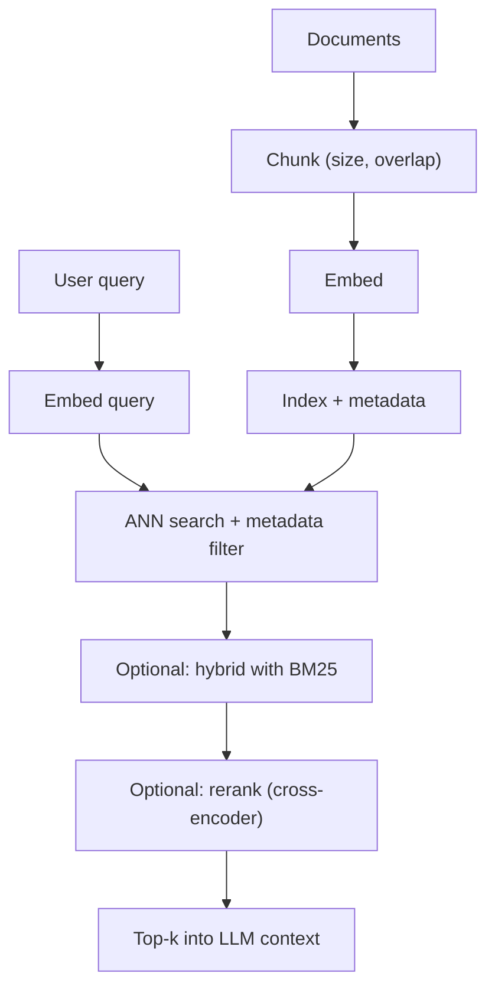

# Vector Databases

> [!abstract] TL;DR
> A vector database stores **embeddings**: dense vectors that capture meaning. It returns the vectors closest to a query vector. ==It trades exact nearest-neighbour search for approximate search (ANN), which is much faster and loses a little recall.== It is the retrieval engine behind most [[Retrieval-Augmented Generation|RAG]] systems and a common long-term store for [[AI Memory]]. Retrieval quality depends more on chunking, the embedding model and metadata filters than on which database you pick.

**Prerequisites:** [[Large Language Models]]
**Related:** [[Retrieval-Augmented Generation]] · [[Agentic RAG]] · [[Agent Based RAG]] · [[Agents and Databases]] · [[AI Memory]] · [[Knowledge Graphs]] · [[AI Agents]] · [[LLM Hallucinations]]

> [!note] Source scope
> Written to fill a link from the RAG and memory notes. The content is standard information-retrieval and ANN material (*beyond the lecture*).

> [!todo]- Contents
> - [[#1. Core Concepts]]
> - [[#2. Similarity Metrics]]
> - [[#3. Indexing – Approximate Nearest Neighbour]]
> - [[#4. The Retrieval Pipeline]]
> - [[#5. Worked Example – Runbook Search]]
> - [[#6. Pitfalls and Failure Modes]]
> - [[#7. Key Takeaways]]
> - [[#8. Critical Analysis]]
> - [[#9. Self-Test]]
> - [[#10. Glossary]]
> - [[#Further Reading]]

---

## 1. Core Concepts

> [!info]+ Definition – Embedding
> A function $f: \text{text} \to \mathbb{R}^d$ learned so that texts with similar meanings map to nearby vectors. Typical $d$ is 384–3072.

^def-embedding

> [!info]+ Definition – Vector database
> A system that stores vectors with IDs and metadata, indexes them for fast **k-nearest-neighbour (kNN)** search, and supports filtering, updates and persistence.

^def-vector-db

| Option | Examples | When |
|---|---|---|
| Library (in-process) | FAISS, hnswlib | Prototypes, static corpora |
| Extension to an existing DB | pgvector (Postgres), Elasticsearch/OpenSearch kNN | You already run the DB and need joins or ACID |
| Dedicated vector DB | Pinecone, Weaviate, Qdrant, Milvus, Chroma | Large scale, managed, hybrid search features (Chroma is used in-memory in the course exercise: [[Agent Based RAG#3. Layer 1 – Indexing PDFs into Chroma]]) |

---

## 2. Similarity Metrics

$$
\text{cos}(\mathbf{a},\mathbf{b}) = \frac{\mathbf{a}\cdot\mathbf{b}}{\lVert\mathbf{a}\rVert\,\lVert\mathbf{b}\rVert}
\qquad
d_{L2}(\mathbf{a},\mathbf{b}) = \lVert\mathbf{a}-\mathbf{b}\rVert_2
$$

For **unit-normalized** vectors, $\lVert\mathbf{a}-\mathbf{b}\rVert^2 = 2 - 2\cos(\mathbf{a},\mathbf{b})$. Cosine, dot product and L2 then give the same ranking. Use whichever metric the embedding model was trained with.

---

## 3. Indexing – Approximate Nearest Neighbour

Exact kNN compares the query with all $N$ vectors, costing $O(N d)$ per query. ANN indexes give up a little recall for sub-linear search.

| Index | Idea | Strengths | Weaknesses |
|---|---|---|---|
| **Flat** | Brute force | Exact | $O(N)$, slow at scale |
| **HNSW** | Layered proximity graph, greedy search | High recall, fast | Memory-heavy, slow to build |
| **IVF** | Cluster centroids, search the closest `nprobe` lists | Uses less memory | Recall depends on `nprobe` |
| **PQ** | Compress vectors into codes | Very small footprint | Lossy distances |

> [!info]+ Definition – Recall@k (ANN)
> $\text{Recall@}k = \frac{|\text{ANN top-}k \cap \text{exact top-}k|}{k}$. Tuning parameters (HNSW `ef`, IVF `nprobe`) trade this against latency.

^ann-recall

Memory estimate: $N$ vectors × $d$ dims × 4 bytes (float32). For example, 10M × 1024 × 4 B ≈ **41 GB** before index overhead. This is why quantization matters.

---

## 4. The Retrieval Pipeline

- **Chunking.** Chunks that are too small lose context. Chunks that are too large dilute the match. Split on document structure (headings) where you can.
- **Hybrid search.** Combine dense retrieval (for meaning) with lexical BM25 (for exact terms such as error codes and IDs).
- **Reranking.** A cross-encoder re-scores the top ~50 results. It is often the single biggest quality gain.
- **Metadata filters.** Tenant, date, source and access control. These are ==required for multi-tenant security==.

---

## 5. Worked Example – Runbook Search

A NOC agent looks up runbooks for "OLT port flapping after firmware upgrade".

1. Runbooks are chunked by heading, embedded, and stored with `{device_type, vendor, updated_at}`.
2. The query is embedded. Filter `device_type = "OLT"`. HNSW finds the top 50.
3. BM25 finds exact matches on the term "flapping". The two result lists are merged with reciprocal rank fusion.
4. A reranker keeps the top 5, which go into the prompt with their source IDs, so a [[Output Validation|grounding check]] can check the citations.

---

## 6. Pitfalls and Failure Modes

| Failure | Symptom | Mitigation |
|---|---|---|
| Wrong chunking | Relevant fact split across chunks | Structure-aware chunks, overlap, parent-document retrieval |
| Semantic-only search misses IDs | "ERR-4471" not found | Hybrid BM25 |
| Embedding model mismatch | Query and docs embedded by different models | Re-embed the corpus when the model changes; version the index |
| Stale index | Old policy retrieved | Incremental upserts, `updated_at` filter |
| No access-control filter | Data leaks across tenants | Filter at query time on user permissions |
| Retrieval poisoning | Injected doc hijacks the agent | Trusted sources, [[Prompt Injection]] defences |

---

## 7. Key Takeaways

- [ ] Embeddings map meaning to geometry. Similarity is cosine, dot product or L2.
- [ ] ANN (HNSW, IVF, PQ) trades recall for speed. Tune `ef` / `nprobe`.
- [ ] Chunking, hybrid search and reranking matter more than the DB brand.
- [ ] Always apply metadata and permission filters.
- [ ] Version the embedding model together with the index.

---

## 8. Critical Analysis

- **Limits.** Similarity is not relevance, and it is not truth. Vector search is weak at negation ("not X"), multi-hop questions, and aggregation ("how many…"). [[Knowledge Graphs]] or SQL fit those better.
- **Is a separate database needed.** For corpora under ~10M vectors, pgvector or an in-process index is often enough, and it avoids running a separate system.
- **Evaluation.** Measure retrieval separately from generation: recall@k and MRR against labelled query–document pairs. Then measure answer faithfulness ([[LLM Evaluation]]).
- **Security.** Embeddings can leak information about the source text (inversion attacks are an active research area). Treat them as sensitive data.

> [!question] Discussion
> 1. When would you pick a knowledge graph over a vector store for agent memory?
> 2. How would you detect index staleness automatically?

---

## 9. Self-Test

> [!question]- Q1. Why do vector databases use approximate search?
> Exact kNN is $O(Nd)$ per query. ANN indexes such as HNSW give sub-linear search at a small cost in recall.

> [!question]- Q2. Quantitative – memory for 2M vectors at d = 768 in float32
> $2\times10^6 \times 768 \times 4 \approx 6.1$ GB, before index overhead.

> [!question]- Q3. A user searches for an exact error code and gets nothing relevant. Why, and what's the fix?
> Dense embeddings blur rare exact tokens. Add hybrid BM25 lexical search.

> [!question]- Q4. Design – multi-tenant RAG for ISP customer-support docs
> Store `tenant_id` and access-control metadata on each chunk and enforce the filter on the server side at query time. Keep a separate namespace per tenant if isolation must be strict. Log what was retrieved.

> [!tip] Flashcards
> Review with [[Vector Databases - Flashcards]].

---

## 10. Glossary

| Term | Meaning |
|---|---|
| ANN | Approximate nearest neighbour search |
| HNSW | Hierarchical Navigable Small World graph index |
| IVF | Inverted file index (cluster-based) |
| PQ | Product quantization (vector compression) |
| Reranker | Cross-encoder that re-scores retrieved candidates |
| Hybrid search | Dense + lexical retrieval combined |

---

## Further Reading

- [HNSW paper (Malkov & Yashunin)](https://arxiv.org/abs/1603.09320)
- [FAISS](https://github.com/facebookresearch/faiss)
- [pgvector](https://github.com/pgvector/pgvector)
- [Retrieval-Augmented Generation (Lewis et al., 2020)](https://arxiv.org/abs/2005.11401)
