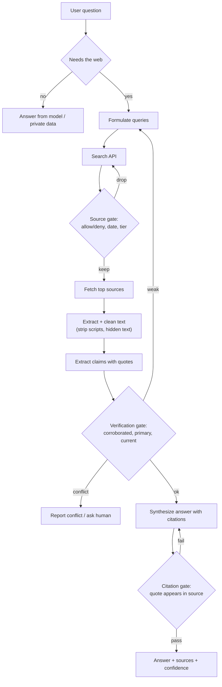

# Web Search and Browsing for AI Agents

> [!abstract] TL;DR
> Web search and browsing tools let an AI get information newer than its training data and from the long tail its weights never memorized. Search returns ranked links and snippets; browsing fetches and reads whole pages, sometimes interactively. The web is also full of stale, wrong, low-effort and adversarial content, and an LLM will repeat it fluently and with citations. ==Treat every web result as untrusted evidence, not truth: guardrails must filter sources, verify claims against independent and primary sources, check that citations actually support what is claimed, and abstain when the evidence is weak.==

**Prerequisites:** [[Tool Use]] · [[Retrieval-Augmented Generation]] · [[APIs in AI Systems]]
**Related:** [[LLM Hallucinations]] · [[Prompt Injection]] · [[Gate Checks]] · [[Output Validation]] · [[AI Reliability]] · [[Agent State Management]] · [[AI Memory]] · [[Model Context Protocol]]

> [!note] Source scope
> Concept hub with no dedicated lecture. It builds on [[Retrieval-Augmented Generation]] (web search is RAG over an index you don't control), [[Tool Use]] and [[Gate Checks]]. Everything is *beyond the lecture*. The source tiers, scoring formula and thresholds are engineering suggestions, not standards. Provider-specific search tools are described generically.

> [!todo]- Contents
> - [[#1. Core Concepts]]
> - [[#2. Why Agents Need the Web]]
> - [[#3. Search vs Browse – How the Tools Work]]
> - [[#4. The Web Research Pipeline]]
> - [[#5. The Core Pitfall – Low-Quality and Inaccurate Data]]
> - [[#6. Guardrails – Defense in Depth]]
> - [[#7. Implementing the Guardrails]]
> - [[#8. Connecting to State, Memory and APIs]]
> - [[#9. Worked Example – Router End-of-Life Question]]
> - [[#10. Pitfalls and Failure Modes]]
> - [[#11. Key Takeaways]]
> - [[#12. Critical Analysis]]
> - [[#13. Self-Test]]
> - [[#14. Glossary]]
> - [[#Further Reading]]

---

## 1. Core Concepts

> [!info]+ Definition – Web search tool
> A tool that sends a query to a search engine or search API and returns a ranked list of results (title, URL, snippet, sometimes date). The model sees summaries of pages, not the pages themselves.

^def-web-search

> [!info]+ Definition – Web fetch / browsing tool
> A tool that retrieves a specific URL and returns its content, usually converted to text or markdown. *Interactive* browsing goes further: the agent drives a real or headless browser to click, scroll, fill forms and read JavaScript-rendered pages.

^def-browsing

> [!info]+ Definition – Web grounding
> Basing a model's answer on retrieved web content, with each claim traceable to a cited source, instead of on parametric memory alone.

^def-grounding

> [!info]+ Definition – Source quality
> How likely a source is to be accurate, current and relevant for a given claim. It depends on authority, primacy (first-hand or not), recency, independence and evidence, not on ranking position or fluency.

^def-source-quality

---

## 2. Why Agents Need the Web

| Need | Why weights alone fail | Example |
|---|---|---|
| Freshness | Knowledge stops at the training cutoff | Today's outage status, current prices, a new API version |
| Long tail | Rare facts are poorly memorized and easily hallucinated ([[LLM Hallucinations]]) | Spec sheet for an obscure device |
| Verifiability | Users and auditors need sources | "According to the vendor bulletin dated…" |
| Breadth | No private corpus covers everything | Competitive research, regulations in many jurisdictions |
| Action | Some tasks happen *on* websites | Checking a portal, filling a form (with permission) |

Web access converts a closed-book model into an open-book one. That is a large accuracy gain when the book is good, and a liability when it isn't.

---

## 3. Search vs Browse – How the Tools Work

| | Web search | Web fetch | Interactive browsing |
|---|---|---|---|
| Input | Query string (+ filters: domains, recency, region) | URL | Goal + browser actions |
| Output | Ranked links + snippets | Page text (HTML converted to text) | Page states, screenshots, accessibility tree |
| Cost / latency | Low | Medium (download + parse) | High (many steps, each a model call) |
| Information depth | Shallow; snippets can mislead | Full page | Full page + dynamic content |
| Main risks | Snippet out of context; SEO-ranked junk | Extraction errors; injected text | Injection, unintended actions, credential exposure |
| Typical use | Find candidate sources | Read and quote a chosen source | Sites needing JS, navigation or login |

Where the tool runs:

| Placement | How | Tradeoff |
|---|---|---|
| Provider-side (built-in) | Model provider runs search for you and returns cited results | Simple; less control over sources and filtering |
| Client-side tool | Your code calls a search API and returns results as a tool result | Full control: allow/deny lists, scoring, logging |
| MCP server | A search or browser server exposed via [[Model Context Protocol]] | Reusable across hosts; you must trust the server |

---

## 4. The Web Research Pipeline



^research-pipeline

This is an agent loop ([[Building Agents with Tools in Python#^agent-loop]]) with **gates** at three points ([[Gate Checks]]): which sources may enter, which claims may be used, and whether the final answer's citations hold up. The loop back from the verification gate is what separates a research agent from "search once and summarize".

---

## 5. The Core Pitfall – Low-Quality and Inaccurate Data

An LLM can't tell a vendor's official bulletin from a content farm's paraphrase of a forum rumour unless you make it check. Worse, it **launders** bad data: a shaky claim comes out in confident prose with a citation attached.

### 5.1 Taxonomy of bad web data

| Category | What it looks like | Why it fools the model |
|---|---|---|
| Stale | Correct in 2022, wrong now; undated pages | Pages rarely say "this is outdated" |
| Low-effort / content farm | SEO articles, listicles, scraped rewrites | Fluent, keyword-rich, ranks well |
| AI-generated filler | Plausible pages produced at scale, often with errors | Reads like authoritative prose |
| Misinformation / satire | False claims, parody sites | Same surface form as news |
| Opinion presented as fact | Forums, comments, reviews | Snippets strip the "I think" |
| Wrong entity | Same name, different product, person or version | Keyword match ≠ meaning match |
| Out-of-context snippet | A quote that is negated or qualified on the full page | Search snippets are fragments |
| Circular sourcing | Ten sites repeating one original (possibly wrong) claim | Looks like corroboration |
| Extraction failure | Tables scrambled, JS content missing, paywall stub, cookie banner text | The model reasons over garbage text |
| Adversarial content | Hidden instructions, SEO poisoning aimed at LLMs | Text is read as instructions ([[Prompt Injection]]) |

^bad-data-taxonomy

### 5.2 Failures on the model's side

Even with good sources, the model can:

- **Misattribute:** cite source A for a claim that came from source B or from its own memory.
- **Over-generalize:** turn "in one study of 40 users" into "users prefer".
- **Fabricate citations:** produce a plausible URL or quote that doesn't exist.
- **Blend:** merge two conflicting sources into a confident middle answer that neither supports.
- **Ignore dates:** treat a 2019 figure as current.

> [!warning] Citations are not verification
> A citation shows *where* a claim supposedly came from. Unless code checks that the cited page exists, was actually fetched, and contains supporting text, the citation is just more generated text. See [[LLM Hallucinations#3. Mitigation Stack]].

---

## 6. Guardrails – Defense in Depth

No single check catches everything, so layer them, as in [[Prompt Injection#4. Defenses – Defense in Depth]].

| Layer | Guardrail | Catches |
|---|---|---|
| 1. Decide | Search only when needed; route stable facts to internal data | Unnecessary exposure to web noise |
| 2. Query | Specific queries with entity, version and date; domain and recency filters | Wrong-entity and stale results |
| 3. Source gate | Allow/deny lists, source tiers, date requirement, dedupe by origin | Content farms, known-bad domains, circular sourcing |
| 4. Content hygiene | Strip scripts, hidden text and boilerplate; size limits; mark content as untrusted data | Injection, extraction garbage |
| 5. Claim verification | Corroborate with *independent* sources; prefer primary sources; check dates; flag conflicts | Single-source errors, outdated facts |
| 6. Citation gate | Every factual claim needs a citation whose quoted text appears in the fetched page | Fabricated or misattributed citations |
| 7. Output policy | State confidence; show conflicts; abstain when evidence is insufficient | False certainty |
| 8. Action and memory policy | Web content can't trigger side effects or be written to long-term memory without verification or a human | Injection-driven actions, memory poisoning |
| 9. Monitoring | Log sources and verdicts; sample answers for audit; track error rates by domain | Drift, new bad sources |

^guardrail-layers

### 6.1 Source tiers

A practical (not standard) tiering, applied **per claim type**:

| Tier | Source type | Use for |
|---|---|---|
| 1 – Primary | Official docs, vendor bulletins, standards bodies, government data, the original paper or dataset | Facts about that organization's own products, rules or data |
| 2 – Reviewed | Peer-reviewed journals, established reference works | Scientific and technical claims |
| 3 – Reputable secondary | Major news outlets with corrections policies, recognized trade press | Events, context |
| 4 – Community | Forums, Q&A sites, issue trackers, blogs by known experts | Workarounds, anecdotes, leads to primary sources |
| 5 – Unknown / low | Content farms, anonymous sites, undated pages, aggregators | Leads only; never sole support for a claim |

^source-tiers

> [!tip] Tier depends on the claim
> A vendor's site is Tier 1 for its own end-of-life dates but biased for "which product is best". A forum is low-tier for facts but may be the *only* source for a bug workaround, so use it, label it, and test it.

### 6.2 Scoring sources

One way to combine signals into a single score (weights tuned on your own evaluation set):

$$\text{score}(s) = w_a\,A(s) + w_r\,e^{-\lambda\,\text{age}(s)} + w_c\,C(s) + w_m\,M(s)$$

where $A$ = authority from the tier, the exponential = recency decay (larger $\lambda$ for fast-changing topics like prices), $C$ = corroboration by independent sources, and $M$ = relevance match to the specific entity and version.

^source-score

### 6.3 The corroboration math, and why independence matters

If each **independent** source is wrong with probability $q$, the chance that $k$ of them agree on the same wrong claim is at most

$$P(\text{all } k \text{ wrong}) \le q^{k}$$

With $q = 0.2$: one source gives 20% risk, two independent sources ≤ 4%, three ≤ 0.8%.

But sources that **copy each other** aren't independent. If ten pages all trace back to one blog post, the effective number of sources is $k_{\text{eff}} = 1$, and the risk is still $q$. Corroboration must count **origins**, not URLs.

^corroboration-math

---

## 7. Implementing the Guardrails

*Illustrative pseudocode.* `search`, `fetch`, `extract_claims` and `llm` stand in for your own tools.

```python
ALLOW_TIER1 = {"vendor.example.com", "nist.gov", "rfc-editor.org"}
DENY = {"known-content-farm.example"}

def source_gate(result, topic):
    d = domain(result.url)
    if d in DENY:
        return "drop"
    if topic.needs_recent and (result.date is None or age_days(result.date) > topic.max_age_days):
        return "drop"                                   # stale or undated
    return "keep"

def verify_claim(claim, sources):
    supporting = [s for s in sources if supports(s.text, claim.quote)]
    origins = {s.origin_id for s in supporting}         # dedupe copies of one original
    has_primary = any(tier(s) == 1 for s in supporting)
    conflicting = [s for s in sources if contradicts(s.text, claim)]
    if conflicting:
        return "conflict"
    if has_primary or len(origins) >= 2:
        return "verified"
    return "weak"

def citation_gate(answer, fetched_pages):
    for c in answer.citations:
        page = fetched_pages.get(c.url)
        if page is None or not fuzzy_contains(page.text, c.quote):
            return False                                # cited but never fetched, or quote absent
    return True
```

^guardrail-code

Design choices:
- **Deterministic first.** Domain lists, dates and quote matching are code checks. Use an LLM judge only for "does this passage support this claim", and validate its output ([[Output Validation]]).
- **Quotes, not paraphrases.** Making the model extract the supporting quote turns "is this cited correctly" into a string check.
- **Conflicts are results.** "Sources disagree: A says X, B says Y" is a better answer than a blended guess.
- **Untrusted wrapping.** Put fetched text inside clearly labelled data blocks and tell the model it is evidence to evaluate, never instructions. This reduces but doesn't eliminate injection.

---

## 8. Connecting to State, Memory and APIs

| Vault concept | Web-research version |
|---|---|
| Agent state ([[Agent State Management#^state-fields]]) | Add `sources` (URL, origin, tier, date, fetched text hash) and `claims` (text, quote, verdict) fields, so gates can read provenance |
| Message payload cost ([[APIs in AI Systems#^quadratic-cost]]) | Fetched pages are large. Store full text outside the prompt and put only extracted quotes into messages |
| Long-term memory ([[AI Memory#3. Write, Retrieve, Forget]]) | Never write unverified web claims into memory. Store provenance and a timestamp with every web-derived fact so it can expire |
| Tools and MCP ([[Tool Use]], [[Model Context Protocol]]) | Search and fetch are just tools. A narrow `fetch(url)` with allow-lists beats a general browser for most tasks |
| Gates ([[Gate Checks]]) | Source gate, verification gate and citation gate map onto content and logic gates |
| Reliability ([[AI Reliability#^error-compounding]]) | Each unverified hop (search → snippet → summary → memory) compounds error |

> [!important] Memory poisoning is the long-term risk
> A wrong web fact that lands in long-term memory gets retrieved in future sessions *without* its original context, and now looks like something the agent "knows". Provenance plus expiry is the minimum defence.

---

## 9. Worked Example – Router End-of-Life Question

User (NOC engineer): *"Is the AX-3000 router end-of-life? Do we need to replace our fleet this year?"*

| Step | What happens | Guardrail |
|---|---|---|
| 1. Query | `"AX-3000" end of life announcement vendor` with the vendor domain preferred | Specific entity and intent |
| 2. Search results | (a) Forum thread "AX-3000 is EOL, dump it!" 2024 · (b) Reseller blog "AX-3000 discontinued" undated · (c) Vendor bulletin PDF 2025-11 · (d) "AX-3000**S**" spec page | Source gate: (b) dropped as undated; (d) flagged as a different model |
| 3. Fetch | Vendor bulletin and forum thread | Content hygiene: PDF text extracted, length capped |
| 4. Claims | Bulletin: "End of sale 2026-06-30; end of software maintenance 2028-06-30; end of support 2029-06-30". Forum: "EOL now" | Quotes extracted for each claim |
| 5. Verify | The bulletin is Tier 1 for the vendor's own lifecycle. The forum conflicts but is Tier 4, and its "EOL" means end-of-sale | Primary source wins; the conflict is explained, not hidden |
| 6. Answer | "Not end-of-support yet. Sales end 2026-06-30, security fixes until 2028-06-30, support until 2029-06-30 [vendor bulletin, Nov 2025]. Plan replacement before mid-2028 rather than this year." | Citation gate: dates appear verbatim in the fetched bulletin |

Without guardrails, the likely answer was "Yes, it's EOL, replace it now," sourced from the forum and the reseller: confident, cited and wrong in a way that costs money.

> [!example] Lesson
> The highest-ranked and most emphatic sources were the least reliable. The key moves were distinguishing the *entity* (AX-3000 vs AX-3000S), the *term* (end-of-sale vs end-of-support) and the *authority* (vendor vs forum).

---

## 10. Pitfalls and Failure Modes

| Failure | Symptom | Mitigation |
|---|---|---|
| Answering from snippets | Claims that the full page qualifies or contradicts | Fetch and quote the page before relying on it |
| Trusting rank | Top result is SEO content | Source tiers and allow/deny lists, not position |
| Counting copies as corroboration | "Five sources agree", all from one origin | Dedupe by origin; require independent or primary support ([[#^corroboration-math]]) |
| Ignoring dates | Outdated prices, versions, policies | Recency filters; require dates for time-sensitive claims; show "as of" dates |
| Wrong entity | Facts about a similar product or person | Include exact identifiers in queries; entity check in the verification gate |
| Fabricated or misattributed citations | Cited page lacks the claim | Citation gate with quote matching ([[#^guardrail-code]]) |
| Blending conflicts | Confident middle answer no source supports | Detect contradictions; report them |
| Extraction garbage | Model reasons over cookie banners or broken tables | Clean extraction; detect low-content pages; re-fetch or skip |
| Indirect prompt injection | Agent follows instructions in a page | Content as data; no side effects from web content; human gates ([[Prompt Injection]]) |
| Data exfiltration via URLs | Agent fetches an attacker URL with private data in the query string | Fetch allow-lists; never build URLs from private data; block untrusted-content + private-data + outbound-request combinations ([[Prompt Injection#^lethal-trifecta]]) |
| Writing web claims to memory | Wrong facts resurface in later sessions | Verification and provenance required before memory writes |
| Runaway browsing | Dozens of fetches, high cost, no answer | Step and token budgets; stop when evidence is sufficient |

---

## 11. Key Takeaways

- [ ] Search finds candidates; fetching and reading the page is what provides evidence.
- [ ] Web content is untrusted evidence: it may be stale, low-quality, wrong or adversarial ([[#^bad-data-taxonomy]]).
- [ ] Guardrails are layered: decide, query, source gate, hygiene, verification, citation gate, output policy, action/memory policy, monitoring ([[#^guardrail-layers]]).
- [ ] Source authority depends on the claim; primary sources win for facts about their own domain ([[#^source-tiers]]).
- [ ] Corroboration only counts *independent origins* ([[#^corroboration-math]]).
- [ ] Citations must be verified by code: the quote has to appear in a page that was actually fetched.
- [ ] Report conflicts and abstain when evidence is weak; don't blend.
- [ ] Never let web content trigger actions or enter long-term memory unverified.

---

## 12. Critical Analysis

**Search quality is outside your control.** Unlike [[Retrieval-Augmented Generation|RAG]] over a curated corpus, the web index is ranked by someone else's objectives (engagement, ads, SEO). Guardrails are compensating for an upstream ranker whose incentives don't match accuracy.

**The web is filling up with model output.** As AI-generated pages grow, agents increasingly cite text written by other models, which may itself rest on hallucinations. This makes origin tracing and primary-source preference more important over time, and makes "many sources agree" weaker evidence.

**Generative engine optimization.** Content is now written to be picked up and repeated by AI systems. Some of it is legitimate structuring; some is manipulation (planted claims, hidden instructions). Expect adversarial pressure on any widely used web agent, the same way search engines face SEO spam.

**Verification has a cost.** Each extra fetch and judge call adds latency and tokens. A reasonable policy scales verification with stakes: casual questions get one good source, while decisions with money, safety, legal or medical impact need primary sources plus independent corroboration, or a human.

**LLM judges are imperfect verifiers.** "Does this passage support this claim" is easier than open-ended fact-checking but still error-prone, especially with negation, numbers and units. Combine judge verdicts with deterministic checks (quote matching, number extraction, date comparison) and measure judge accuracy on a labelled set.

**Evaluation.** Useful metrics: claim-level precision (fraction of claims supported by their citations), citation validity rate, primary-source rate, conflict-detection recall, abstention rate on unanswerable questions, and cost per answer. Long-form factuality methods such as FActScore and SAFE decompose answers into atomic claims and check each one, which matches this note's claim-level design ([[LLM Evaluation]]).

**Security is not optional.** Browsing combines untrusted content with tool access, the exact setup that makes indirect prompt injection dangerous. A browsing agent that can also read private data and make outbound requests has all three parts of the "lethal trifecta".

> [!question] Discussion questions
> - How should an agent handle a question where the only sources are Tier 4–5?
> - Should source allow-lists be global, per task, or per claim type?
> - How would you detect that two sources share an origin when neither links to it?
> - When is it acceptable for a web research agent to answer without any citation?

---

## 13. Self-Test

> [!question]- Q1. What is the difference between a web search tool and a web fetch tool, and why does it matter for accuracy
> Search returns ranked links and short snippets; fetch retrieves a page's full content. Snippets are fragments that can omit qualifiers or negations, so claims should be checked against fetched page text before being used.

> [!question]- Q2. Name five kinds of low-quality or inaccurate web data an agent might pull
> Any five of: stale pages, content-farm/SEO articles, AI-generated filler, misinformation or satire, opinion presented as fact, wrong-entity pages, out-of-context snippets, circular sourcing, extraction failures, adversarial content with hidden instructions.

> [!question]- Q3. Why isn't "ten websites say the same thing" strong evidence
> They may all copy one original source, so they aren't independent. Corroboration should count distinct origins; ten copies of one wrong claim are as weak as one.

> [!question]- Q4. Quantitative – Each independent source is wrong 15% of the time. What is the maximum chance that three agreeing independent sources are all wrong? What if all three copied one original
> Independent: $0.15^3 \approx 0.0034$ (about 0.34%). All copied from one origin: effectively one source, so 15%.

> [!question]- Q5. How can code verify a citation rather than trusting it
> Require the model to give a supporting quote with each citation, then check that the URL was actually fetched in this run and that the quote (or a close fuzzy match) appears in the fetched text. Fail the citation gate otherwise and regenerate or drop the claim.

> [!question]- Q6. Design – Build guardrails for an agent that answers customers' questions about telecom regulations using web search
> Restrict queries to the relevant jurisdiction and add recency filters. Allow-list Tier 1 sources (regulator sites, official gazettes) and treat law-firm blogs and news as secondary. Require every regulatory claim to cite a primary source with a verbatim quote and effective date. Flag conflicts and superseded rules. Abstain and escalate to compliance staff when no primary source is found. Wrap fetched text as untrusted data, let no web content trigger actions, log all sources for audit, and run periodic evaluation of claim precision on a labelled set.

> [!question]- Q7. Why shouldn't unverified web facts be written to long-term memory
> They would be retrieved in later sessions without their original context or source quality, and look like established knowledge. Errors and injected content would persist and spread. Store only verified facts, with provenance and expiry.

> [!question]- Q8. How can a browsing agent leak private data, and how do you stop it
> Injected instructions on a page can make it fetch an attacker-controlled URL with private data in the query string, or submit it through a form. Mitigations: fetch allow-lists, never construct URLs from private data, require confirmation for outbound actions, and avoid combining private data access, untrusted content and outbound requests in one unsupervised agent.

### Flashcards

> [!tip] Flashcards
> Review this topic with [[Web Search and Browsing for AI Agents - Flashcards]] (Spaced Repetition plugin → **Review flashcards**).

---

## 14. Glossary

| Term | Meaning |
|---|---|
| Web search tool | Tool returning ranked results and snippets for a query |
| Web fetch tool | Tool retrieving and converting the content of one URL |
| Interactive browsing | Agent driving a browser: click, scroll, type, read rendered pages |
| Web grounding | Basing answers on retrieved web content with traceable citations |
| SERP | Search engine results page: the ranked list a search returns |
| Source tier | Authority level of a source for a given claim type |
| Primary source | First-hand origin of a fact: official docs, original data, the original paper |
| Corroboration | Support for a claim from independent sources |
| Circular sourcing | Sources that look independent but repeat one origin |
| Citation gate | Check that each citation's quote appears in a fetched page |
| Abstention | Declining to answer, or answering with stated uncertainty, when evidence is insufficient |
| Content farm | Site producing high volumes of low-effort, search-optimized pages |
| Generative engine optimization | Writing content so AI systems pick it up and repeat it |
| Memory poisoning | Wrong or malicious content persisted into an agent's long-term memory |

---

## Further Reading

- [Nakano et al. (2021) – WebGPT: Browser-assisted question-answering with human feedback](https://arxiv.org/abs/2112.09332)
- [Greshake et al. (2023) – Not what you've signed up for: Compromising real-world LLM-integrated applications with indirect prompt injection](https://arxiv.org/abs/2302.12173)
- [Min et al. (2023) – FActScore: Fine-grained atomic evaluation of factual precision in long-form text generation](https://arxiv.org/abs/2305.14251)
- [Wei et al. (2024) – Long-form factuality in large language models (SAFE)](https://arxiv.org/abs/2403.18802)
- [Asai et al. (2023) – Self-RAG: Learning to retrieve, generate, and critique through self-reflection](https://arxiv.org/abs/2310.11511)
- [OWASP Top 10 for Large Language Model Applications](https://owasp.org/www-project-top-10-for-large-language-model-applications/)

%%
Study hint: take any answer an AI gave you with web citations, open each cited page, and check whether the quoted claim is actually there and current. You'll find failures from section 5 quickly.
%%
